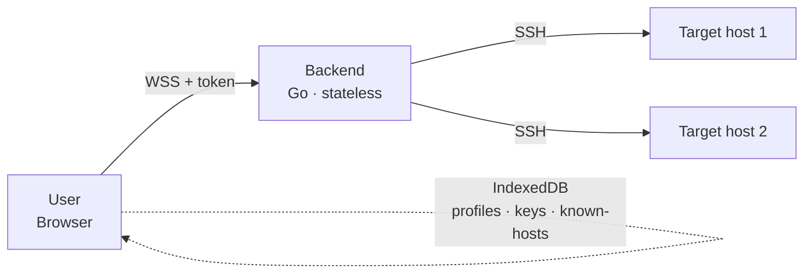

# Buddy-SSH

> A secure, enterprise-grade WebSSH platform — browser-based SSH with a
> stateless backend, client-side encryption, and proper host-key
> verification. Built with Vue 3 and Go.

**Status:** 📐 Design phase (Phases 1-10 complete; implementation follows the
[roadmap](./docs/10-roadmap.md)).

---

## ✨ Vision

Buddy-SSH lets you securely access remote systems through SSH from any modern
browser and device, without installing client software and **without the
backend ever persisting credentials**. It is designed to feel like a
professional desktop SSH client while remaining entirely browser-based, and to
serve as a long-term foundation for SFTP, port forwarding, workspaces,
plugins, and enterprise deployment.

## 🧱 Architecture at a glance



- **Frontend** — Vue 3.5 + TypeScript 7 + Vite 8 + Pinia 3 + xterm.js +
  Tailwind. Owns the terminal UI, connection profiles, local encryption, and
  host-key trust database.
- **Backend** — Go 1.26.5, stateless SSH transport. Terminates a WebSocket,
  opens an SSH session, allocates a PTY, bridges bytes. Holds no durable
  state; each WebSocket owns exactly one SSH session.
- **Shared protocol** — TypeScript types in `packages/shared` are the single
  source of truth; Go types are generated. MessagePack on the wire.

## 🔒 Security principles

- **No backend secret storage.** Passwords, keys, passphrases, and sessions
  are never persisted server-side.
- **No user accounts.** The backend is a secure SSH transport layer, not an
  identity provider.
- **Client-side encryption.** Optional private-key persistence uses
  Argon2id + AES-256-GCM via Web Crypto; the master password never leaves
  the browser.
- **Host-key verification (TOFU).** First-use fingerprint pinning in a
  client-side encrypted known-hosts database; changed keys are never silently
  trusted.
- **Defense in depth.** Strict CSP, Trusted Types, origin allowlist, shared
  static bearer token, structured logging with redaction.

## 📚 Documentation

Full design documentation lives in [`docs/`](./docs/README.md):

| # | Document |
|---|----------|
| 1 | [Software Requirements Specification](./docs/01-srs.md) |
| 2 | [Threat Model (STRIDE)](./docs/02-threat-model.md) |
| 3 | [Architecture Decision Records](./docs/adr/) (0001-0009) |
| 4 | [Frontend Design](./docs/04-frontend-design.md) |
| 5 | [Backend Design](./docs/05-backend-design.md) |
| 6 | [WebSocket Protocol Specification](./docs/06-websocket-protocol.md) |
| 7 | [Browser Storage Specification](./docs/07-storage-spec.md) |
| 8 | [Cryptography Specification](./docs/08-crypto-spec.md) |
| 9 | [Sequence & State Diagrams](./docs/09-diagrams.md) |
| 10 | [Implementation Roadmap](./docs/10-roadmap.md) |

## 🗺️ Roadmap (MVP = M0-M2)

| Milestone | Title |
|-----------|-------|
| **M0** | Scaffold & tooling |
| **M1** | Single SSH session (password auth) |
| **M2** | Multi-tab sessions |
| M3 | SSH key + keyboard-interactive auth |
| M4 | Host-key TOFU + encrypted known-hosts |
| M5 | Connection profiles (IndexedDB) |
| M6 | Local key encryption (Argon2id + AES-GCM) |
| M7 | Hardening: CSP, Trusted Types, PWA |
| M8 | Test suite: integration, E2E, a11y, perf |
| M9 | Docker polish + release workflow |

See [`docs/10-roadmap.md`](./docs/10-roadmap.md) for full scope, deliverables,
and exit criteria.

## 🛠️ Tech stack

| Layer | Choice |
|-------|--------|
| Frontend | Vue 3.5.40, TypeScript 7.0, Vite 8.1.5, Pinia 3.0.4, Vue Router, xterm.js, TailwindCSS, VueUse, Zod, TanStack Query |
| Backend | Go 1.26.5, `golang.org/x/crypto/ssh`, `coder/websocket`, `creack/pty` |
| Protocol | MessagePack (primary), JSON (debug); shared TS types + Go codegen |
| Storage | IndexedDB (profiles, encrypted keys, known-hosts) |
| Crypto | Argon2id (`hash-wasm`) + AES-256-GCM (Web Crypto) |
| Tooling | bun + Go workspaces, no monorepo orchestrator |
| Deploy | Multi-stage non-root Docker + docker-compose |

## 🚀 Quick start (after implementation)

```bash
# generate a backend token
echo "BUDDY_SSH_TOKEN=$(openssl rand -hex 32)" > .env

# local dev
make dev

# or docker
make docker-up
```

Then open `https://localhost:8443`.

> ⚠️ The MVP (M0-M2) ships with a permissive host-key callback and is intended
> for trusted-network / VPN deployment only. Production use requires M4
> (host-key TOFU). See [`docs/01-srs.md`](./docs/01-srs.md) §9.2.

## 📄 License

See [LICENSE](./LICENSE).
