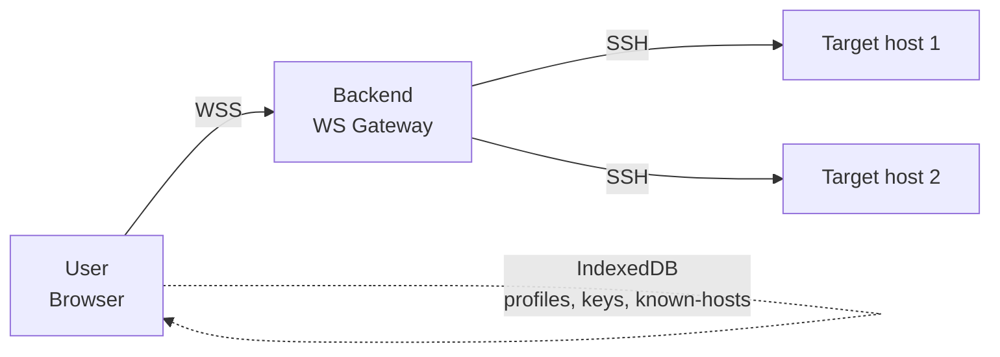

# Phase 1 — Software Requirements Specification (SRS)

**Document status:** Proposed
**Last updated:** 2026-07-26
**Scope:** Buddy-SSH WebSSH platform (frontend + backend + shared protocol)

This specification follows IEEE 830 structure, adapted for a single-product
monorepo. It is the authoritative source of *what* the system must do and *how
well*; it deliberately avoids prescribing *how* — that is the job of the
design documents ([`04`](./04-frontend-design.md)–[`08`](./08-crypto-spec.md))
and the [ADRs](./adr/).

---

## 1. Introduction

### 1.1 Purpose

Buddy-SSH is a browser-based SSH client that lets users securely access remote
systems from any modern browser and device, without installing client software
and without the backend ever persisting credentials. The platform is designed
to feel comparable to a professional desktop SSH client while remaining
entirely browser-based, and to serve as a long-term foundation for SFTP, port
forwarding, workspaces, plugins, and enterprise deployment.

### 1.2 Scope

The platform comprises:

- A **Vue 3 frontend** (SPA) that owns the terminal UI, connection profiles,
  local encryption, and host-key trust database.
- A **Go backend** that acts as a stateless SSH transport: it terminates a
  WebSocket, opens an SSH session to the user-supplied target, allocates a
  PTY, and bridges bytes bidirectionally.
- A **shared protocol** (`packages/shared`) that defines the WebSocket wire
  format consumed by both sides, with Go types generated from the TypeScript
  source of truth (see [ADR-0001](./adr/0001-monorepo-structure.md) and
  [ADR-0004](./adr/0004-websocket-encoding.md)).

Out of scope for the initial platform: SFTP browser, port forwarding, SOCKS
proxy, jump hosts, session recording, plugins, AI assistant. These are
architected *for* but not implemented in the MVP (see
[`10-roadmap.md`](./10-roadmap.md)).

### 1.3 Definitions, acronyms, abbreviations

See the [glossary in `docs/README.md`](./README.md#glossary). Additional
terms:

| Term | Meaning |
|------|---------|
| Connection profile | Saved host metadata (hostname, port, username, prefs). Never contains secrets. |
| Master password | User-chosen passphrase that derives the local encryption key. Never transmitted, never stored. |
| Known-hosts DB | Client-side, encrypted store of pinned SSH host keys (TOFU). |
| Session | One logical SSH connection, owned by exactly one WebSocket. |
| Tab | One UI representation of a session in the tab bar. |

### 1.4 References

- `PROMPT.md` — project vision and constraints (repository root).
- [RFC 4251](https://www.rfc-editor.org/rfc/rfc4251) — SSH architecture.
- [RFC 4252](https://www.rfc-editor.org/rfc/rfc4252) — SSH authentication.
- [RFC 4254](https://www.rfc-editor.org/rfc/rfc4254) — SSH connection protocol.
- [RFC 6455](https://www.rfc-editor.org/rfc/rfc6455) — WebSocket protocol.
- [OWASP ASVS 4.0](https://owasp.org/www-project-application-security-verification-standard/) — app security verification.
- [WCAG 2.1 AA](https://www.w3.org/TR/WCAG21/) — accessibility.

### 1.5 Overview

§2 describes the overall product. §3 lists functional requirements. §4 lists
non-functional requirements. §5 lists constraints. §6 lists stakeholders and
use cases. §7 covers assumptions and dependencies. §8 covers risks. §9 marks
MVP vs deferred scope.

---

## 2. Overall description

### 2.1 Product perspective

Buddy-SSH is a self-hosted web application. The backend is a single Go binary
serving HTTPS/WSS; the frontend is a static SPA served by the same binary (or
a reverse proxy). The backend holds **no durable state** — every byte of
credential and host-trust data lives in the browser.

### 2.2 Product functions (summary)

1. Open SSH sessions to arbitrary hosts from the browser.
2. Authenticate via password, SSH key, or keyboard-interactive.
3. Render an interactive terminal (xterm.js) with full ANSI/Unicode/OSC support.
4. Manage multiple concurrent sessions via tabs.
5. Save connection profiles locally (no secrets).
6. Optionally persist encrypted private keys locally (master-password derived).
7. Verify host keys on first use and warn on mismatch (TOFU).
8. Reconnect transparently after transient network failures.

### 2.3 User characteristics

- **Individual operator** — a developer or sysadmin self-hosting Buddy-SSH for
  personal use. Comfortable with SSH concepts.
- **Team operator** — a small team sharing one Buddy-SSH instance behind a
  reverse proxy / VPN. No shared accounts; each browser is independent.
- **Enterprise operator** — deploys behind corporate SSO/VPN; relies on
  network-layer access control plus the backend's shared static token.

### 2.4 Constraints

See §5.

### 2.5 Assumptions and dependencies

See §7.

---

## 3. Functional requirements

Each requirement has a stable ID (`FR-N`), a priority
(`MVP` / `P1` / `P2` / `Future`), and a verification method
(`T` = automated test, `M` = manual, `I` = inspection).

### 3.1 Connection management

| ID | Requirement | Priority | Verify |
|----|-------------|----------|--------|
| FR-1 | The user shall be able to open an SSH session by supplying hostname, port, username, and an authentication method. | MVP | T |
| FR-2 | The user shall be able to specify a custom SSH port (default 22). | MVP | T |
| FR-3 | The system shall support password authentication. | MVP | T |
| FR-4 | The system shall support private-key authentication (unencrypted and passphrase-protected keys, OpenSSH and PEM formats). | P1 | T |
| FR-5 | The system shall support keyboard-interactive authentication. | P1 | T |
| FR-6 | The user shall be able to disconnect a session explicitly; the backend shall close the SSH channel and PTY promptly. | MVP | T |
| FR-7 | The system shall support keepalive packets on both the WebSocket and SSH layers to detect dead peers. | MVP | T |
| FR-8 | The system shall support automatic reconnection with exponential backoff after a transient WebSocket drop, requiring re-authentication. | P1 | T |
| FR-9 | The system shall support a "reconnect all" action across tabs. | P1 | M |
| FR-10 | The backend shall enforce a configurable idle timeout after which an authenticated session with no traffic is closed. | P1 | T |

### 3.2 Terminal

| ID | Requirement | Priority | Verify |
|----|-------------|----------|--------|
| FR-20 | The terminal shall render UTF-8, Unicode (including CJK and emoji), 256-color and truecolor ANSI, and common OSC sequences (title, hyperlink per OSC 8). | MVP | T |
| FR-21 | The terminal shall support dynamic resize; the frontend shall debounce resize events and emit a RESIZE message; the backend shall issue an SSH window-change request. | MVP | T |
| FR-22 | The terminal shall support configurable scrollback (default 10 000 lines, max 100 000). | MVP | M |
| FR-23 | The terminal shall support copy/paste via clipboard API and keyboard shortcuts, including bracketed paste. | MVP | T |
| FR-24 | The terminal shall support drag-and-drop of plain text into the pane. | P1 | M |
| FR-25 | The terminal shall support themes (dark/light minimum), font family, font size, line height, and cursor style. | MVP | M |
| FR-26 | The terminal shall support in-buffer search (case-sensitive and regex). | P1 | T |
| FR-27 | The terminal shall support an accessibility mode that announces connection state changes via ARIA live regions. | P1 | M |
| FR-28 | The terminal shall sanitize or neutralize malicious escape sequences that could hijack the clipboard or rewrite the title bar in a misleading way. | MVP | T |

### 3.3 Multi-session / tabs

| ID | Requirement | Priority | Verify |
|----|-------------|----------|--------|
| FR-40 | The user shall be able to open an "unlimited" number of concurrent sessions, bounded only by client memory and backend resources. | MVP | T |
| FR-41 | Each session shall be represented by a tab showing a label, an activity indicator, and a disconnected indicator. | MVP | M |
| FR-42 | The user shall be able to rename, close, duplicate, and pin tabs. | MVP | M |
| FR-43 | The user shall be able to reorder tabs via drag-and-drop. | P1 | M |
| FR-44 | The user shall be able to assign color labels to tabs. | P1 | M |
| FR-45 | The user shall be able to organize profiles into folders (UI-ready; full folder UX is P1). | P1 | M |

### 3.4 Connection profiles

| ID | Requirement | Priority | Verify |
|----|-------------|----------|--------|
| FR-60 | The user shall be able to save a connection profile containing hostname, port, username, nickname, auth type, terminal preferences, connection preferences, tags, notes, and color. | P1 | T |
| FR-61 | The system shall **never** automatically save passwords or passphrases. | MVP | T |
| FR-62 | Saving an encrypted private key locally shall be strictly opt-in and shall require a master password. | P1 | T |
| FR-63 | The user shall be able to edit, delete, import, and export profiles (export excludes any secrets). | P1 | T |
| FR-64 | Profiles shall be stored in IndexedDB, never in localStorage or sessionStorage. | P1 | T |

### 3.5 Host-key verification 🔒

| ID | Requirement | Priority | Verify |
|----|-------------|----------|--------|
| FR-80 | On first connect to a host, the system shall display the host key fingerprint (SHA-256, Base64) and require explicit user acceptance before proceeding. | P1 | T |
| FR-81 | Accepted host keys shall be pinned in a client-side encrypted known-hosts database (IndexedDB). | P1 | T |
| FR-82 | On subsequent connects, the system shall verify the presented host key against the pinned value; a mismatch shall abort the connection and present a prominent warning. | P1 | T |
| FR-83 | The system shall never silently trust a changed host key. | P1 | T |
| FR-84 | The known-hosts database shall be encrypted with a key derived from the master password (subkey via HKDF). | P1 | T |
| FR-85 | The backend shall verify host keys using trust data supplied by the client per connection; the backend shall never persist a trust database. | P1 | T |

### 3.6 Authentication & secret handling 🔒

| ID | Requirement | Priority | Verify |
|----|-------------|----------|--------|
| FR-100 | The backend shall accept credentials only over an authenticated WSS connection. | MVP | T |
| FR-101 | The backend shall hold credentials only in memory for the minimum time required to authenticate the SSH session, then release them. | MVP | T |
| FR-102 | The backend shall never log passwords, private keys, passphrases, tokens, terminal contents, or environment variables. | MVP | T |
| FR-103 | The backend shall zero sensitive buffers where practical (Go runtime makes best-effort guarantees; documented). | P1 | I |
| FR-104 | The frontend shall decrypt private keys only when required to establish a connection and shall keep decrypted material in memory for the minimum time required. | P1 | T |
| FR-105 | The frontend shall auto-lock the local key store after a configurable idle period (default 15 min) or on tab close. | P1 | T |

### 3.7 Backend access control 🔒

| ID | Requirement | Priority | Verify |
|----|-------------|----------|--------|
| FR-120 | The backend shall require a shared static bearer token on every WebSocket upgrade request. | MVP | T |
| FR-121 | The token shall be configured via the `BUDDY_SSH_TOKEN` environment variable; the backend shall fail to start if it is unset or empty. | MVP | T |
| FR-122 | The token comparison shall be constant-time. | MVP | T |
| FR-123 | The backend shall reject cross-origin WebSocket upgrades unless the origin is on an explicit allowlist (`BUDDY_SSH_ALLOWED_ORIGINS`). | MVP | T |

### 3.8 UX

| ID | Requirement | Priority | Verify |
|----|-------------|----------|--------|
| FR-140 | The UI shall provide a command palette (Cmd/Ctrl+K) for quick actions. | P1 | M |
| FR-141 | The UI shall provide a "quick connect" dialog accepting `user@host:port`. | P1 | M |
| FR-142 | The UI shall provide a favorites/recent-hosts list. | P1 | M |
| FR-143 | The UI shall provide keyboard shortcuts for common actions (new tab, close tab, switch tab, reconnect, copy, paste). | MVP | M |
| FR-144 | The UI shall support dark and light themes, following the OS preference by default. | MVP | M |
| FR-145 | The UI shall be responsive: a desktop layout on wide screens and a touch-friendly mobile layout on narrow screens. | P1 | M |

### 3.9 Future-ready (architected for, not implemented)

| ID | Requirement | Priority |
|----|-------------|----------|
| FR-160 | The protocol shall reserve message-type ranges for SFTP, port forwarding, and file transfer. | Future |
| FR-161 | The frontend shall be structured to allow split panes and floating terminals without major rewrites. | Future |
| FR-162 | The plugin/extension API shall be designed but is out of scope for the initial platform. | Future |
| FR-163 | AI-assisted tooling shall be strictly opt-in and shall never transmit terminal contents or credentials without explicit per-action consent. | Future |

---

## 4. Non-functional requirements

### 4.1 Performance

| ID | Requirement | Target | Verify |
|----|-------------|--------|--------|
| NFR-P1 | Connection setup latency (WS upgrade → first byte from remote PTY) | < 1 s on a LAN target | T |
| NFR-P2 | Terminal keystroke-to-echo latency (local typing) | < 50 ms p95 | T |
| NFR-P3 | Resize latency (debounce end → PTY window-change applied) | < 100 ms p95 | T |
| NFR-P4 | WebSocket throughput (sustained) | ≥ 5 MB/s per session | T |
| NFR-P5 | Frontend bundle (gzipped, initial) | < 350 kB | T |
| NFR-P6 | Memory per active session (frontend) | < 8 MB typical | T |

### 4.2 Security

See [`02-threat-model.md`](./02-threat-model.md) for the full STRIDE analysis.
Headline requirements:

| ID | Requirement | Verify |
|----|-------------|--------|
| NFR-S1 | All transport is WSS (TLS 1.2+); plaintext WS is refused in production. | T |
| NFR-S2 | A strict Content-Security-Policy is served; no `unsafe-inline` for scripts. | T |
| NFR-S3 | Trusted Types are enforced where the browser supports them. | T |
| NFR-S4 | The backend stores no secrets at rest (no DB, no disk cache of credentials). | I |
| NFR-S5 | Local encryption uses AES-256-GCM with Argon2id key derivation. | T |
| NFR-S6 | Host-key verification (TOFU) is enforced; changed keys never auto-trusted. | T |
| NFR-S7 | Structured logs never include secrets; a redaction filter is enforced. | T |

### 4.3 Accessibility

| ID | Requirement | Verify |
|----|-------------|--------|
| NFR-A1 | Conform to WCAG 2.1 AA. | M |
| NFR-A2 | All interactive controls reachable and operable via keyboard. | M |
| NFR-A3 | Screen-reader announcements for connection state, errors, and tab changes. | M |
| NFR-A4 | Respect `prefers-reduced-motion`. | M |
| NFR-A5 | High-contrast theme available. | M |

### 4.4 Reliability & availability

| ID | Requirement | Verify |
|----|-------------|--------|
| NFR-R1 | The backend shall shut down gracefully on SIGTERM: stop accepting new connections, drain active sessions up to a configurable deadline, then exit. | T |
| NFR-R2 | A backend crash shall not corrupt any user data (all state is in the browser). | I |
| NFR-R3 | The frontend shall survive a backend restart by offering reconnection per tab. | T |

### 4.5 Maintainability

| ID | Requirement | Verify |
|----|-------------|--------|
| NFR-M1 | The codebase shall pass `tsc --noEmit`, `go vet`, `golangci-lint`, and `biome check` with zero errors in CI. | T |
| NFR-M2 | Unit test coverage ≥ 70 % for `crypto/`, `services/`, `internal/ssh/`, `internal/websocket/`. | T |
| NFR-M3 | Every ADR shall be linked from at least one design doc and vice-versa. | I |

### 4.6 Observability

| ID | Requirement | Verify |
|----|-------------|--------|
| NFR-O1 | Every WebSocket connection shall carry a generated request ID propagated to logs. | T |
| NFR-O2 | Logs shall be structured JSON (slog) with levels configurable via env. | T |
| NFR-O3 | Optional Prometheus metrics endpoint: active connections, connection duration histogram, bytes transferred (no payload). | P1 | T |

### 4.7 Compatibility

| ID | Requirement | Verify |
|----|-------------|--------|
| NFR-C1 | Frontend supports the latest two major versions of Chrome, Firefox, Safari, and Edge. | M |
| NFR-C2 | Backend builds with Go 1.26.5 and runs on linux/amd64 and linux/arm64. | T |
| NFR-C3 | The container image is non-root and distroless or alpine-based. | I |

---

## 5. Constraints

1. **Languages & versions**: Go 1.26.5, TypeScript 7.0, Vue 3.5.40, Vite 8.1.5,
   Pinia 3.0.4 — fixed by `PROMPT.md`.
2. **No backend secret storage**: the backend must not persist passwords,
   usernames, keys, passphrases, or sessions. (FR-100..104, NFR-S4.)
3. **No user accounts**: the platform has no notion of a server-side user.
4. **No custom cryptography**: only Web Crypto API and audited libraries
   (`hash-wasm` for Argon2id). (See [`08-crypto-spec.md`](./08-crypto-spec.md).)
5. **Stateless backend**: each WebSocket owns exactly one SSH session; no
   server-side session map. (See [ADR-0005](./adr/0005-stateless-backend.md).)
6. **Tooling**: bun for JS, Go modules/workspaces for Go, no monorepo
   orchestrator. (See [ADR-0007](./adr/0007-tooling.md).)
7. **Open-source**: the project must remain self-hostable and open-source.

---

## 6. Stakeholders & use cases

### 6.1 Stakeholders

| Stakeholder | Interest |
|-------------|----------|
| End user (operator) | Reliable, fast, private SSH access from any browser. |
| Self-hoster | Easy deployment, clear docs, low resource footprint. |
| Enterprise admin | Predictable security posture, auditability, SSO/VPN-friendly. |
| Maintainer | Clean architecture, testability, low bus factor. |
| Security reviewer | Defense in depth, no secret persistence, threat-model coverage. |

### 6.2 Primary use cases

**UC-1 — Quick connect (MVP)**
1. User opens the SPA.
2. User enters `user@host:port` and a password in the quick-connect dialog.
3. On first connect, user accepts the host key fingerprint (P1; in MVP the
   backend uses a permissive callback documented as a known gap).
4. A tab opens; the terminal is interactive.

**UC-2 — Multi-tab workflow (MVP)**
1. User opens several sessions as in UC-1.
2. User switches tabs; each tab preserves its own scrollback and connection.
3. User closes a tab; the underlying session is disconnected.

**UC-3 — Saved profile (P1)**
1. User saves a profile from an active session (no secrets saved).
2. On next visit, user clicks the profile, supplies a password or unlocks a
   stored key, and connects.

**UC-4 — Reconnect after network drop (P1)**
1. The WebSocket drops.
2. The tab shows a "reconnecting" indicator.
3. The client retries with exponential backoff, re-authenticates, and resumes
   the terminal (scrollback preserved client-side).

**UC-5 — Host key mismatch (P1)**
1. User connects to a previously-pinned host whose key has changed.
2. The connection is aborted; a prominent warning is shown with both
   fingerprints; the user must explicitly choose to re-pin (with friction).

---

## 7. Assumptions & dependencies

### 7.1 Assumptions

- The backend is deployed behind a TLS-terminating reverse proxy or serves
  its own TLS certificate in production.
- The operator is responsible for network-layer access control (VPN, IP
  allowlist) in addition to the shared static token.
- Browsers used support Web Crypto, IndexedDB v2, and WebSocket.
- The SSH target host speaks RFC 4252/4254 SSH-2.

### 7.2 External dependencies

| Dependency | Purpose | Notes |
|------------|---------|-------|
| `golang.org/x/crypto/ssh` | SSH client | Go team maintained. |
| `coder/websocket` (nhooyr) | WebSocket server | See [ADR-0003](./adr/0003-backend-stack.md). |
| `creack/pty` | PTY allocation | Linux/macOS; Windows target not supported initially. |
| xterm.js + addons | Terminal emulator | See [`04-frontend-design.md`](./04-frontend-design.md). |
| `hash-wasm` | Argon2id KDF | See [`08-crypto-spec.md`](./08-crypto-spec.md). |
| `@msgpack/msgpack` | Protocol encoding | See [ADR-0004](./adr/0004-websocket-encoding.md). |
| Zod | Runtime schema validation | Frontend + shared types. |
| TanStack Query | Async server state | See [ADR-0006](./adr/0006-frontend-state-management.md). |

---

## 8. Risks

| Risk | Likelihood | Impact | Mitigation |
|------|-----------|--------|------------|
| XSS exfiltrates decrypted keys from memory. | Medium | Critical | Strict CSP, Trusted Types, no `v-html` for terminal output, code review. |
| Backend token leaks (logs, process args). | Low | Critical | Read token from env only; never log; redaction filter; document deployment. |
| Changed host key goes unnoticed (TOFU bypass). | Low | High | Mandatory mismatch warning; no "always trust" checkbox. |
| Malicious escape sequence hijacks clipboard. | Medium | High | Sanitize OSC 52 / title sequences; disable clipboard writes by default. |
| Browser storage compromise (lost device). | Medium | High | Master-password encryption; auto-lock; never store passwords. |
| Dependency supply-chain attack. | Low | Critical | Lockfile, dependency audit in CI, minimal deps, provenance checks. |
| WebSocket hijacking (CSWSH). | Medium | High | Origin allowlist + token on upgrade. |
| Backend resource exhaustion (DoS). | Medium | Medium | Per-connection limits, idle timeout, rate-limit upgrades. |

---

## 9. MVP vs deferred scope

### 9.1 MVP (roadmap M0-M2)

- Monorepo scaffold, CI, Docker skeleton.
- Single SSH session with password auth.
- Multi-tab UI (open, switch, close, rename, pin).
- Terminal: UTF-8, ANSI, resize, scrollback, copy/paste, themes.
- Backend: WSS gateway, shared static token, PTY, keepalive, graceful shutdown.
- Strict CSP, structured logging with redaction.

### 9.2 Deferred (designed, implemented in later milestones)

- SSH key + keyboard-interactive auth (M3).
- Host-key TOFU + encrypted known-hosts (M4).
- Connection profiles + IndexedDB (M5).
- Local key encryption (Argon2id + AES-GCM) (M6).
- Hardening: Trusted Types, PWA, permissions policy (M7).
- Full test suite: integration, E2E, a11y, performance (M8).
- Docker polish + release workflow (M9).

> **Note on MVP host-key handling:** The MVP ships with a permissive host-key
> callback on the backend (logs the fingerprint, accepts the key). This is a
> **known, documented security gap** closed in M4. The MVP is intended for
> trusted-network / VPN deployment only; production use requires M4.

---

## 10. Open questions

None blocking. The following are flagged for resolution during implementation:

1. Should the backend support SSH agent forwarding? (Architected for; default
   off; revisit in M3+.)
2. Should the frontend offer session recording (client-side only)? (Future;
   privacy review required.)
3. WebAuthn for unlocking the local key store — supported in M6 or deferred?
   (Lean: deferred to a post-M6 hardening pass.)
