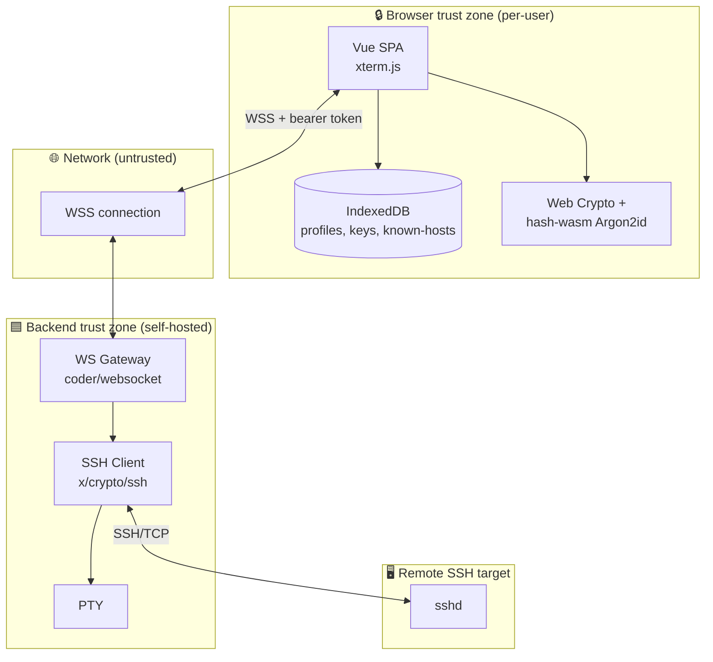

# Phase 2 — Threat Model (STRIDE)

**Document status:** Proposed
**Last updated:** 2026-07-26
**Method:** [STRIDE](https://learn.microsoft.com/en-us/azure/security/develop/threat-modeling-tool-threats#stride-model)
**Scope:** Buddy-SSH platform — frontend (browser SPA), backend (Go WSS
gateway), shared WebSocket protocol, browser storage, and the SSH transport
path to remote targets.

This document is the authoritative security analysis. Every mitigation here is
traced to a requirement in [`01-srs.md`](./01-srs.md) (§3.5-3.7, §4.2) and to
the design docs that implement it.

---

## 1. System boundary & trust zones



**Trust zones:**

| Zone | Trust level | Notes |
|------|-------------|-------|
| Browser | Trusted *per user* | Compromise = full compromise of that user's data. Hardened via CSP, Trusted Types, no secret persistence without master password. |
| Network (WSS) | Untrusted | TLS mandatory; origin allowlist + token on upgrade. |
| Backend | Semi-trusted | Stateless, no secrets at rest; receives credentials ephemerally. |
| SSH target | Untrusted until verified | TOFU host-key verification (M4). |

**Assets:**

| Asset | Where | Sensitivity |
|-------|-------|-------------|
| SSH password | Browser memory → WSS → backend memory (transient) | Critical |
| SSH private key (decrypted) | Browser memory (transient) → WSS → backend memory (transient) | Critical |
| Master password | Browser memory only — never transmitted, never stored | Critical |
| Derived encryption key | Browser memory (non-extractable CryptoKey) | Critical |
| Encrypted private keys | IndexedDB | High (encrypted at rest) |
| Known-hosts DB | IndexedDB | High (encrypted at rest) |
| Connection profiles | IndexedDB | Medium (no secrets) |
| Terminal contents | Browser memory, xterm.js buffer | Medium (may contain secrets typed by user) |
| Backend bearer token | Env var → backend memory; browser memory | Critical |
| Host key fingerprint | Browser → backend (per connection) | Medium |

---

## 2. STRIDE per component

### 2.1 Frontend (Vue SPA)

| Threat | Category | Vector | Mitigation | Requirement |
|--------|----------|--------|------------|-------------|
| XSS via terminal output | Spoofing / Info disclosure | Remote host emits `<script>` or HTML; rendered via `v-html` | xterm.js writes to canvas/DOM text nodes, never `v-html`; strict CSP `script-src 'self'`; Trusted Types enforce DOM sinks | NFR-S2, NFR-S3, FR-28 |
| XSS via dependency | Info disclosure / Elevation | Malicious npm package executes in SPA context | Lockfile pinned, `bun audit` in CI, minimal deps, Subresource Integrity for CDN assets (avoid CDN entirely) | NFR-S2, §8 risks |
| Prototype pollution | Tampering / Elevation | Malicious object merges `__proto__` | No `v-html`; Zod parses all external input; avoid `Object.assign` on untrusted data; `Object.create(null)` for maps | NFR-S2 |
| Clipboard leakage | Info disclosure | Malicious OSC 52 sequence writes to clipboard | Disable OSC 52 clipboard writes by default; explicit opt-in; sanitize title sequences | FR-28, NFR-S2 |
| ANSI injection | Spoofing | Escape sequences rewrite title or simulate prompts | xterm.js parser isolates sequences; never echo raw escapes into the DOM outside the terminal | FR-28 |
| Master password capture | Spoofing | Phishing overlay / fake unlock prompt | Unlock prompt is app-modal, CSP-blocks inline scripts; consider WebAuthn second factor (future) | FR-104, NFR-S5 |
| Memory scraping (lost device) | Info disclosure | Attacker reads IndexedDB / memory dump | Master-password encryption; auto-lock; never store passwords; zeroize plaintext after use | FR-104, FR-105, NFR-S5 |
| Session fixation | Spoofing | Attacker injects a session ID | No server sessions exist; each WS is independent; token is per-deployment, not per-session | NFR-S4, ADR-0005 |

### 2.2 Backend (Go WSS gateway)

| Threat | Category | Vector | Mitigation | Requirement |
|--------|----------|--------|------------|-------------|
| Credential logging | Info disclosure | `log.Printf` accidentally includes password | Structured `slog`; redaction filter on all log fields; tests assert no secret substrings appear in logs | FR-102, NFR-S7 |
| Credential persistence | Info disclosure | Backend writes creds to disk/DB | No DB; no disk cache; in-memory only; zero buffers where practical | FR-101, FR-103, NFR-S4 |
| CSWSH (cross-site WebSocket hijacking) | Spoofing / Elevation | Browser opens WSS to backend from malicious origin | Origin allowlist (`BUDDY_SSH_ALLOWED_ORIGINS`); token required on upgrade | FR-123, NFR-S1 |
| Token brute force | Spoofing | Attacker guesses bearer token | 256-bit random token; constant-time compare; rate-limit failed upgrades | FR-120, FR-122 |
| DoS via connection flood | DoS | Attacker opens many WS connections | Per-IP upgrade rate limit; max connections cap; idle timeout | NFR-R1, §8 |
| DoS via large frames | DoS | Attacker sends oversized WS frames | `coder/websocket` read limit; per-message size cap | NFR-R1 |
| Timing attack on token compare | Spoofing | Attacker measures compare time | `subtle.ConstantTimeCompare` | FR-122 |
| MITM on backend→target SSH | Spoofing / Info disclosure | Attacker intercepts SSH | TOFU host-key verification (M4); backend never trusts silently | FR-80..85 |
| Repudiation | Repudiation | Operator denies actions | Request IDs in logs; backend logs connection metadata (host, user, duration) — never secrets | NFR-O1, NFR-O2 |

### 2.3 WebSocket protocol

| Threat | Category | Vector | Mitigation | Requirement |
|--------|----------|--------|------------|-------------|
| Protocol downgrade | Tampering / Spoofing | Attacker forces old protocol version | `protocol-version` field; backend rejects unknown versions; no silent fallback | FR (protocol §6) |
| Message injection | Tampering / Elevation | Attacker injects DATA/RESIZE out of band | Token on upgrade; per-connection state machine rejects out-of-order messages | ADR-0004, §6 |
| Replay of AUTH | Spoofing | Attacker replays a captured AUTH frame | AUTH only valid in the AUTH state, once per connection; connection-bound | §6 state machine |
| Type confusion | Tampering / Elevation | Malformed MessagePack decodes to unexpected shape | Zod schema validation on frontend; generated Go types + explicit decode on backend | ADR-0004 |

### 2.4 Browser storage (IndexedDB)

| Threat | Category | Vector | Mitigation | Requirement |
|--------|----------|--------|------------|-------------|
| Storage compromise (lost device) | Info disclosure | Attacker reads IndexedDB | AES-256-GCM encryption for keys + known-hosts; master password never stored | FR-62, NFR-S5, §7 spec |
| Storage tampering | Tampering | Attacker modifies encrypted blob | AES-GCM authenticated encryption detects modification; version field | NFR-S5, §8 spec |
| Quota exhaustion | DoS | Attacker (or bug) fills storage | Quota checks; bounded scrollback; profile count limits | §7 spec |
| Cross-origin access | Info disclosure | Another origin reads IndexedDB | Same-origin policy; SOP enforced by browser; backend serves SPA from same origin | NFR-S2 |

### 2.5 SSH transport

| Threat | Category | Vector | Mitigation | Requirement |
|--------|----------|--------|------------|-------------|
| Host key spoofing | Spoofing | MITM presents wrong key | TOFU + mismatch warning; never auto-trust changed keys | FR-80..83 |
| Weak ciphers | Info disclosure | Negotiation falls back to weak cipher | Backend SSH client config restricts to modern algorithms (curve25519, aes256-gcm, etc.) | §5 design |
| Credential reuse after disconnect | Info disclosure | Backend keeps creds around | Zero buffers; creds go out of scope after `ssh.Dial` returns | FR-101, FR-103 |

---

## 3. Attack vector catalog

Each vector from `PROMPT.md` §Security is mapped to mitigations and residual
risk.

| # | Attack | STRIDE | Mitigations | Residual risk | Owner |
|---|--------|--------|-------------|---------------|-------|
| 1 | XSS (terminal output, dependency, v-html) | S/I/E | xterm.js (no v-html), CSP, Trusted Types, lockfile, bun audit | Low (defense in depth) | Frontend |
| 2 | CSRF | S/T | No cookies for auth; bearer token in WS subprotocol/header; origin allowlist | Low | Backend |
| 3 | WebSocket hijacking (CSWSH) | S/E | Origin allowlist + token on upgrade; WSS only | Low | Backend |
| 4 | Clickjacking | S | `X-Frame-Options: DENY`; CSP `frame-ancestors 'none'` | Very low | Backend headers |
| 5 | MITM (browser↔backend) | S/I | TLS 1.2+ mandatory; HSTS; no mixed content | Low | Ops |
| 6 | MITM (backend↔target) | S/I | TOFU host-key verification (M4); restricted SSH ciphers | Medium pre-M4, Low post-M4 | Backend |
| 7 | Session fixation | S | No server sessions; stateless backend | Very low | Backend |
| 8 | Clipboard leakage | I | OSC 52 disabled by default; explicit opt-in; sanitize title | Low | Frontend |
| 9 | Browser storage compromise | I | AES-256-GCM + Argon2id; master password; auto-lock | Medium (offline attack on weak master pw) | Frontend |
| 10 | Malicious terminal escape sequences | S/T/I | xterm.js parser; no DOM echo; sanitize OSC 52/title | Low | Frontend |
| 11 | ANSI injection | S/T | Same as #10; bracketed paste | Low | Frontend |
| 12 | DoS (connection flood, large frames) | D | Upgrade rate limit; max conns; read limit; idle timeout | Medium | Backend |
| 13 | Brute force (backend token) | S | 256-bit token; constant-time compare; rate limit | Very low | Backend |
| 14 | Timing attacks (token compare) | S | `subtle.ConstantTimeCompare` | Very low | Backend |
| 15 | Supply-chain attack (npm/Go modules) | I/E | Lockfile, `bun audit`, `govulncheck`, minimal deps, provenance | Medium (inherent) | CI/CD |
| 16 | Dependency confusion | I/E | Scoped registries; lockfile; no wildcard imports | Low | CI/CD |
| 17 | Prototype pollution | T/E | Zod parsing; `Object.create(null)`; no unsafe merges | Low | Frontend |

---

## 4. Secret lifecycle (data flow)

```mermaid
sequenceDiagram
    autonumber
    participant U as User
    participant SPA as Browser SPA
    participant IDB as IndexedDB
    participant BE as Backend (memory)
    participant T as SSH target
    U->>SPA: Enter master password
    SPA->>SPA: Argon2id → derived key (non-extractable CryptoKey)
    SPA->>IDB: Read encrypted key blob
    SPA->>SPA: AES-GCM decrypt → plaintext key (in memory, transient)
    SPA->>BE: WSS AUTH {password or key} (over TLS)
    BE->>BE: Use credential for ssh.Dial (in memory only)
    BE->>T: SSH handshake + auth
    T-->>BE: Auth result
    BE->>BE: Zero credential buffers; release refs
    BE-->>SPA: CONNECTED / ERROR
    SPA->>SPA: Zero plaintext key buffer
    Note over SPA,IDB: Master password & derived key never leave browser
    Note over BE: Backend never persists, never logs credentials
```

**Invariants:**

1. The master password and derived encryption key **never** leave the browser.
2. Decrypted private keys exist in browser memory only for the minimum time
   required to transmit the credential over WSS.
3. The backend receives credentials only over authenticated WSS, uses them
   once for `ssh.Dial`, and releases them immediately.
4. No credential is ever written to disk, logs, or telemetry by the backend.
5. Terminal contents are never logged by the backend.

---

## 5. Browser security headers

The backend (or reverse proxy) must serve the following headers on the SPA and
WSS endpoints. Each is justified below.

| Header | Value | Mitigates |
|--------|-------|-----------|
| `Content-Security-Policy` | `default-src 'self'; script-src 'self'; style-src 'self' 'unsafe-inline' (Tailwind requires); connect-src 'self' wss:; img-src 'self' data:; font-src 'self'; frame-ancestors 'none'; base-uri 'none'; require-trusted-types-for 'script'` | XSS, data exfiltration, clickjacking |
| `Strict-Transport-Security` | `max-age=63072000; includeSubDomains; preload` | MITM, protocol downgrade |
| `X-Frame-Options` | `DENY` | Clickjacking (legacy browsers) |
| `Referrer-Policy` | `no-referrer` | Referrer leakage |
| `Permissions-Policy` | `clipboard-read=(self), clipboard-write=(self), geolocation=(), microphone=(), camera=()` | Feature abuse |
| `Cross-Origin-Opener-Policy` | `same-origin` | Window isolation |
| `Cross-Origin-Embedder-Policy` | `require-corp` (if cross-origin assets needed) | Spectre-class data leakage |
| `Cross-Origin-Resource-Policy` | `same-origin` | Cross-origin resource access |
| `X-Content-Type-Options` | `nosniff` | MIME sniffing |
| `Content-Type` | correct MIME on every response | MIME confusion |

> **Note on `style-src 'unsafe-inline'`:** Tailwind injects styles at runtime.
> A future hardening pass (M7) will move to a hashed or nonce-based policy to
> remove `unsafe-inline`. This is a documented, time-boxed deviation.

---

## 6. Residual risk summary

| Area | Residual risk | Reason | Acceptance |
|------|---------------|--------|------------|
| Master password strength | Medium | User may choose weak password | Accepted; document guidance; future WebAuthn |
| Supply chain | Medium | Inherent to third-party deps | Accepted; minimize + audit + lock |
| Pre-M4 host-key handling | High | MVP uses permissive callback | **Not accepted for production**; MVP is trusted-network only |
| Memory scraping on active tab | Medium | Browser memory is observable | Accepted; auto-lock + short lifetime |
| DoS on backend | Medium | Network-level attacks | Accepted; rate limits + ops guidance |

---

## 7. Verification

Each mitigation is verified by an automated test or inspection step in CI:

- **CSP/headers**: integration test asserts headers on a sample response.
- **Redaction**: unit test feeds secret-shaped strings to logger and asserts
  absence in output.
- **Token compare**: unit test asserts `subtle.ConstantTimeCompare` is used.
- **Origin allowlist**: integration test asserts cross-origin upgrade is
  rejected.
- **Encryption**: unit tests in `crypto/` assert AES-GCM round-trip and that
  tampered ciphertext fails to decrypt.
- **Host-key (M4)**: integration test asserts mismatch aborts connection.
- **xterm.js no v-html**: lint rule / code review checklist forbids `v-html`
  in `terminal/`.

See [`10-roadmap.md`](./10-roadmap.md) for the milestone in which each
verification lands.
