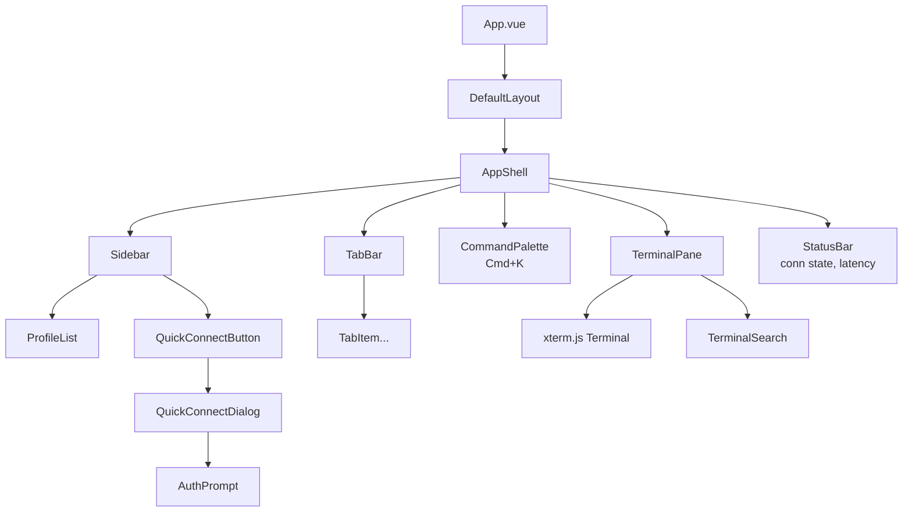
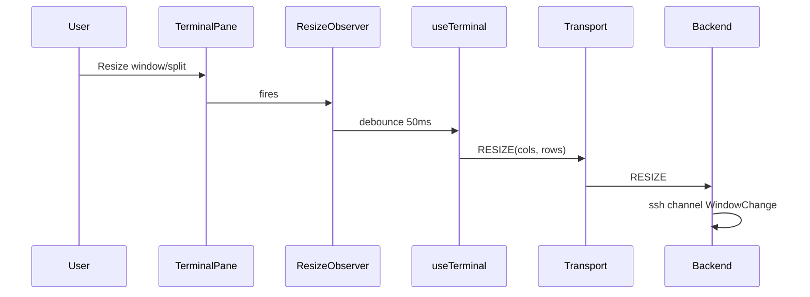

# Phase 4 — Frontend Design

**Document status:** Proposed
**Last updated:** 2026-07-26
**Scope:** `apps/frontend/` — the Vue 3 SPA.

This document specifies the frontend module map, component tree, state
stores, terminal integration, routing, theming, accessibility, and PWA
strategy. It implements the requirements in [`01-srs.md`](./01-srs.md) §3.1,
3.2, 3.3, 3.4, 3.8 and the decisions in [ADR-0002](./adr/0002-frontend-stack.md)
and [ADR-0006](./adr/0006-frontend-state-management.md).

---

## 1. Module map

```
apps/frontend/
    public/                  # static assets, favicon, manifest.webmanifest
    src/
        main.ts              # app bootstrap, Pinia, Router, TanStack Query
        App.vue              # root layout shell
        assets/              # fonts, images, global css
        components/
            layout/          # AppShell, Sidebar, TabBar, StatusBar
            terminal/        # TerminalPane, TerminalSearch, ResizeObserver
            tabs/            # TabItem, TabDragList
            profiles/        # ProfileList, ProfileCard, ProfileEditor
            connect/         # QuickConnectDialog, AuthPrompt
            common/          # Modal, Button, Input, Tooltip, Spinner
            palette/         # CommandPalette
        views/
            WorkspaceView.vue    # main terminal workspace (default route)
            SettingsView.vue     # theme, font, shortcuts, idle timeout
            ProfilesView.vue     # manage saved profiles
        layouts/
            DefaultLayout.vue   # AppShell + <RouterView/>
        stores/
            useSessionStore.ts   # tabs, active tab, per-tab conn state
            useProfileStore.ts   # profiles (IndexedDB-backed)
            useSettingsStore.ts  # theme, font, shortcuts
            useAuthStore.ts      # master password, derived CryptoKey, lock
            useKnownHostsStore.ts# pinned host keys (encrypted)
        services/
            transport.ts         # WebSocket client (coder-style on JS side)
            protocol.ts          # MessagePack encode/decode + Zod validate
            storage.ts           # IndexedDB wrapper (idb library)
            crypto.ts            # Argon2id + AES-GCM (delegates to crypto/)
        composables/
            useTerminal.ts       # xterm.js lifecycle + addons
            useResize.ts         # debounced resize → RESIZE message
            useReconnect.ts      # exponential backoff state machine
            useKeyboardShortcuts.ts
            useTheme.ts          # dark/light + reduced motion
        terminal/
            xtermFactory.ts      # create Terminal + attach addons
            addons.ts            # addon config (Fit, Search, WebLinks, ...)
            sanitize.ts          # OSC 52 / title sequence filtering
            theme.ts             # xterm.js ITheme builders
        crypto/
            kdf.ts               # Argon2id via hash-wasm
            cipher.ts            # AES-256-GCM via SubtleCrypto
            keys.ts              # derive/unlock/lock lifecycle
            zeroize.ts           # best-effort buffer clearing
        workers/
            crypto.worker.ts     # offload KDF + decrypt to worker (P1)
        types/
            index.ts             # re-export from packages/shared
            local.ts             # frontend-only types
        utils/
            assert.ts
            format.ts            # fingerprint formatting, sizes
            id.ts                # request id generation
        router/
            index.ts             # routes, lazy imports, guards
    index.html
    vite.config.ts
    tailwind.config.ts
    tsconfig.json
    package.json
```

---

## 2. Component tree



**Key components:**

| Component | Responsibility |
|-----------|----------------|
| `AppShell` | Grid layout: sidebar + tab bar + pane + status bar. |
| `Sidebar` | Profile list, folders, quick connect, recent hosts. |
| `TabBar` / `TabItem` | Tabs with label, activity dot, disconnected state, color label, drag handle. |
| `TerminalPane` | Hosts one xterm.js instance; owns its WebSocket via `useTerminal`. |
| `CommandPalette` | Cmd/Ctrl+K fuzzy action list (new tab, reconnect, theme, settings). |
| `QuickConnectDialog` | Parses `user@host:port`, collects auth, opens session. |
| `AuthPrompt` | Modal for password / key passphrase / keyboard-interactive challenges. |
| `StatusBar` | Connection state, round-trip latency, backend health. |

---

## 3. State stores

Per [ADR-0006](./adr/0006-frontend-state-management.md). Each store is a
Pinia setup store.

### 3.1 `useSessionStore` (ephemeral)

```ts
interface SessionTab {
  id: string                 // uuid
  profileId?: string         // link to a saved profile, if any
  label: string              // tab title
  color?: string             // tab color label
  pinned: boolean
  state: 'connecting' | 'connected' | 'reconnecting' | 'disconnected' | 'error'
  transport?: Transport      // WebSocket client instance
  error?: string
  lastActivity: number
}
```

Actions: `openTab(profile?)`, `closeTab(id)`, `renameTab(id, label)`,
`duplicateTab(id)`, `pinTab(id)`, `reconnect(id)`, `reconnectAll()`,
`setActive(id)`, `reorder(ids[])`.

### 3.2 `useProfileStore` (IndexedDB-backed)

Holds `Profile[]` (no secrets). Loaded on app start via TanStack Query;
mutations write through to IndexedDB and invalidate the query.

### 3.3 `useSettingsStore` (IndexedDB-backed)

Theme, font family/size, scrollback, idle timeout, shortcuts. Reactive to
`prefers-color-scheme` and `prefers-reduced-motion`.

### 3.4 `useAuthStore` (memory only, secrets) 🔒

```ts
interface AuthState {
  locked: boolean
  derivedKey?: CryptoKey     // non-extractable, never persisted
  createdAt?: number
}
```

Actions: `unlock(masterPassword)`, `lock()`, `rekey(newMaster, oldMaster)`.
`lock()` clears `derivedKey` and all decrypted material in other stores.
Auto-lock via `useIdleTimeout` (default 15 min, FR-105).

### 3.5 `useKnownHostsStore` (encrypted IndexedDB)

Reads/writes the `knownHosts` object store; all values encrypted with a
subkey derived from `useAuthStore.derivedKey` via HKDF
([`08-crypto-spec.md`](./08-crypto-spec.md) §5).

---

## 4. Terminal integration (xterm.js)

### 4.1 Lifecycle (`useTerminal` composable)

1. On tab mount: create `Terminal` with options from `useSettingsStore`.
2. Attach addons: `FitAddon`, `SearchAddon`, `WebLinksAddon`, `SerializeAddon`,
   `ClipboardAddon` (with OSC 52 **disabled** by default, FR-28),
   `WebglAddon` (with canvas fallback).
3. Open in the pane's DOM element; call `fit()`.
4. Wire `transport.onData` → `terminal.write`; `terminal.onData` →
   `transport.send(DATA)`.
5. `useResize` observes the pane; debounced (50 ms) → `transport.send(RESIZE)`.
6. On tab unmount: dispose terminal, cancel transport, clear buffers.

### 4.2 Addon selection

| Addon | Purpose | MVP |
|-------|---------|-----|
| `@xterm/addon-fit` | Auto-size to container | ✅ |
| `@xterm/addon-search` | In-buffer search | ✅ |
| `@xterm/addon-web-links` | OSC 8 hyperlinks | ✅ |
| `@xterm/addon-serialize` | Export buffer (for reconnect restore) | ✅ |
| `@xterm/addon-clipboard` | Clipboard (OSC 52 disabled by default) | ✅ |
| `@xterm/addon-webgl` | GPU renderer | ✅ (fallback canvas) |
| `@xterm/addon-ligatures` | Font ligatures | P1 |

### 4.3 Security hardening (`terminal/sanitize.ts`)

- OSC 52 clipboard writes: disabled unless user opts in per session.
- Title sequences (`OSC 0;...ST`): allowed but truncated; never used for
  security decisions.
- All terminal output goes through xterm.js's parser; **never** `v-html` or
  `innerHTML` of terminal bytes (threat model §2.1).

### 4.4 Resize flow



---

## 5. Routing

```ts
const routes = [
  { path: '/', component: () => import('@/views/WorkspaceView.vue') },
  { path: '/settings', component: () => import('@/views/SettingsView.vue') },
  { path: '/profiles', component: () => import('@/views/ProfilesView.vue') },
]
```

- Lazy-loaded via dynamic imports (NFR-P5 bundle budget).
- A navigation guard prompts before leaving with active sessions (optional).
- Deep links: `/?connect=user@host:port` pre-fills the quick-connect dialog.

---

## 6. Theming

- CSS variables for colors; Tailwind config maps to the same variables.
- `useTheme` composable toggles `dark`/`light` on `<html>`; default follows
  `prefers-color-scheme`.
- xterm.js theme rebuilt from the same variables via `terminal/theme.ts`.
- `prefers-reduced-motion` disables transitions and the WebGL renderer's
  smooth cursor (NFR-A4).

---

## 7. Accessibility (WCAG 2.1 AA)

- All interactive controls are keyboard-reachable; visible focus ring.
- `TabBar` is a `role="tablist"`; tabs are `role="tab"` with `aria-selected`.
- `TerminalPane` has an `aria-live="polite"` sibling announcing connection
  state changes (FR-27).
- Modals trap focus; restore focus on close.
- High-contrast theme variant (NFR-A5).
- Screen-reader-only labels for icon-only buttons.

> **Note:** xterm.js terminals are inherently difficult for screen readers.
  The accessibility mode (FR-27) announces state changes and offers a
  "last-output" region; full terminal screen-reader support is a known
  limitation documented in the accessibility statement.

---

## 8. PWA / offline

- `vite-plugin-pwa` generates a service worker caching the app shell only.
- **Never** cache: credentials, terminal output, decrypted keys, known-hosts
  (threat model §2.4).
- Offline shell lets the UI load without network; connection attempts fail
  gracefully with a "backend unreachable" state.

---

## 9. Performance

- Code-split per view and per heavy component (xterm.js loaded on demand).
- Terminal output is written in batches via `requestAnimationFrame` to avoid
  layout thrash.
- `useResize` debounced; `useReconnect` uses backoff to avoid thundering
  herds.
- Bundle budget enforced in CI (NFR-P5, < 350 kB gzipped initial).

---

## 10. Open items (resolved in later milestones)

1. Split-pane layout (future, FR-161) — component tree reserves a `PaneGroup`
   abstraction.
2. Plugin API (future, FR-162) — a `plugins/` directory and a manifest schema
   are sketched but not implemented.
3. WebAuthn unlock (future) — `useAuthStore.unlock` accepts a pluggable
   `UnlockStrategy` interface.
