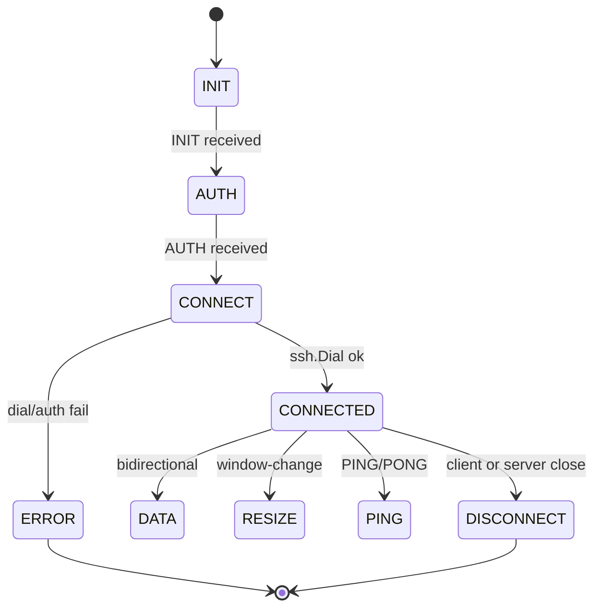

# Phase 5 — Backend Design

**Document status:** Proposed
**Last updated:** 2026-07-26
**Scope:** `apps/backend/` — the Go WebSocket-to-SSH gateway.

This document specifies the backend package layout, WebSocket gateway, SSH
layer, PTY handling, auth middleware, logging, config, telemetry, and
horizontal-scaling notes. It implements the requirements in
[`01-srs.md`](./01-srs.md) §3.1, 3.6, 3.7 and the decisions in
[ADR-0003](./adr/0003-backend-stack.md), [ADR-0005](./adr/0005-stateless-backend.md),
and [ADR-0008](./adr/0008-access-control.md).

---

## 1. Package layout

```
apps/backend/
    cmd/
        buddy-ssh/
            main.go              # entrypoint: config load, server start, graceful shutdown
    internal/
        config/
            config.go            # env-driven config, validated at startup
            config_test.go
        auth/
            token.go             # constant-time token compare
            token_test.go
            origin.go            # origin allowlist
            origin_test.go
        websocket/
            gateway.go           # http.Handler: upgrade, subprotocol, per-conn loop
            gateway_test.go
            conn.go              # per-connection state machine + read/write loops
            conn_test.go
            framing.go           # MessagePack encode/decode (generated types)
        ssh/
            client.go            # ssh.ClientConfig builder, dial, auth methods
            client_test.go
            hostkey.go           # host-key callback (client-supplied trust data)
            hostkey_test.go
            pty.go               # PTY request + window-change
            pty_test.go
            session.go           # Session interface wrapping ssh.Session
        middleware/
            logging.go           # request ID, structured log, redaction
            recovery.go          # panic recovery
            headers.go           # security headers on HTTP responses
            middleware_test.go
        logging/
            logger.go            # slog setup, levels, redaction filter
            logger_test.go
        telemetry/
            metrics.go           # Prometheus collectors (opt-in)
            tracing.go           # OpenTelemetry hooks (opt-in)
        server/
            server.go            # http.Server wiring, health, static SPA
            server_test.go
    go.mod
    go.sum
```

A root `go.work` file (ADR-0007) includes `./apps/backend` so local edits to
generated protocol code are picked up without `replace` directives.

---

## 2. Entrypoint & graceful shutdown

`cmd/buddy-ssh/main.go`:

1. Load `config.Config` from env (§6).
2. Construct `slog.Logger` with redaction filter (§5).
3. Wire middleware: recovery → logging → headers → auth → gateway.
4. Start `http.Server` on configured port.
5. On `SIGINT`/`SIGTERM`: call `server.Shutdown(ctx)` with a configurable
   deadline (default 30 s). Shutdown stops accepting new connections and
   drains active WebSockets; each active connection is given the deadline to
   close cleanly (NFR-R1).

---

## 3. WebSocket gateway (`internal/websocket`)

### 3.1 Upgrade handler (`gateway.go`)

- `GET /ws` — the only WebSocket endpoint.
- `coder/websocket.Accept` with:
  - `Subprotocols: []string{"buddy-ssh.msgpack", "buddy-ssh.json"}` — selects
    encoding (ADR-0004). Defaults to msgpack.
  - `OriginPatterns` from config (ADR-0008, FR-123).
- Token check (§4) before `Accept`.
- On success, spawn a `conn` goroutine group.

### 3.2 Per-connection state machine (`conn.go`)

Each connection owns exactly one SSH session (ADR-0005). The connection
object holds:

```go
type Conn struct {
    ws       *websocket.Conn
    enc      Encoding           // msgpack | json
    log      *slog.Logger       // with request id
    session  *ssh.Session       // nil until CONNECTED
    cancel   context.CancelFunc
}
```

The read loop drives the protocol state machine (see
[`06-websocket-protocol.md`](./06-websocket-protocol.md) §4):



- Out-of-order messages (e.g., DATA before CONNECTED) → `ERROR` and close.
- `SetReadLimit` enforces max frame size (default 1 MiB; threat model §2.2).
- Write loop serializes outbound messages; reads are concurrent with writes.

### 3.3 Framing (`framing.go`)

- Encode/decode using `github.com/vmihailenco/msgpack/v5` (msgpack) or
  `encoding/json` (debug).
- Types are generated from `packages/shared` (ADR-0001, ADR-0004).
- Every decoded message is validated against the generated schema; invalid →
  `ERROR` and close (threat model §2.3).

---

## 4. Auth middleware (`internal/auth`)

### 4.1 Token (`token.go`)

- Reads `config.Token` (from `BUDDY_SSH_TOKEN`).
- `Validate(token string) bool` uses `subtle.ConstantTimeCompare`
  (FR-122).
- Missing or wrong token → `401 Unauthorized` (FR-120).

### 4.2 Origin (`origin.go`)

- `AllowedOrigins []string` from `BUDDY_SSH_ALLOWED_ORIGINS` (comma-separated).
- Empty list → localhost-only (dev default).
- `Validate(r *http.Request) bool` checks the `Origin` header against the
  list; mismatch → `403 Forbidden` (FR-123, threat model §2.2 CSWSH).

### 4.3 Wiring

```go
mux.Handle("/ws",
    middleware.Logging(
        middleware.Headers(
            auth.Origin(
                auth.Token(gateway)))))
```

---

## 5. Logging (`internal/logging`)

- `slog` JSON handler; level via `BUDDY_SSH_LOG_LEVEL` (debug|info|warn|error).
- Every log entry includes `request_id` (generated per WS upgrade),
  `remote_addr`, `target_host`, `target_user`, `session_id`.
- **Redaction filter** (`logger.go`): a handler wrapper that scrubs any field
  whose name matches `password|passphrase|key|token|secret|credential` and
  any value matching common secret shapes. Unit tests assert no secret
  substrings appear in output (FR-102, NFR-S7).
- Terminal DATA contents are **never** logged.

---

## 6. Config (`internal/config`)

```go
type Config struct {
    Port            int           // default 8443
    Token           string        // BUDDY_SSH_TOKEN, required
    AllowedOrigins  []string      // BUDDY_SSH_ALLOWED_ORIGINS
    LogLevel        string        // default info
    IdleTimeout     time.Duration // default 5m
    Keepalive       time.Duration // default 30s (WS + SSH)
    MaxConnections  int           // default 256
    ReadLimit       int64         // default 1 MiB
    ShutdownTimeout time.Duration // default 30s
    TLSCert         string        // optional; if empty, plaintext (dev)
    TLSKey          string
    MetricsEnabled  bool          // default false
}
```

- `Load()` reads env, applies defaults, validates (token required → fail-fast,
  FR-121).
- `Validate()` returns explicit errors for misconfigurations.

---

## 7. SSH layer (`internal/ssh`)

### 7.1 Client config (`client.go`)

- Builds `ssh.ClientConfig` per connection from the INIT/AUTH payloads.
- `Timeout`: 10 s dial timeout.
- `HostKeyCallback`: from `hostkey.go` (§7.2).
- `AuthMethod`: `ssh.Password`, `ssh.PublicKeys` (from parsed key), or
  `ssh.KeyboardInteractive` (FR-3, FR-4, FR-5).
- Restricted algorithms: prefer `curve25519-sha256`, `aes128-gcm@openssh.com`/
  `aes256-gcm@openssh.com`, `hmac-sha2-256-etm@openssh.com`. Reject weak
  ciphers (threat model §2.5).

### 7.2 Host-key callback (`hostkey.go`)

- The client supplies trust data in the INIT message (pinned fingerprint or
  "first-use" flag).
- `HostKeyCallback(hostname, remote, key)`:
  - If pinned: compare `sha256(key)` to the pinned value; mismatch → return
    error (FR-82, FR-83).
  - If first-use: log the fingerprint and accept (MVP behavior; M4 will
    require the frontend to have already pinned it).
- The backend **never** persists trust data (FR-85).

### 7.3 PTY & session (`pty.go`, `session.go`)

- After `ssh.Dial`, request a session, then `RequestPty("xterm-256color",
  rows, cols, modes)`.
- `WindowChange(rows, cols)` on RESIZE (FR-21).
- `Session` wraps `ssh.Session` and exposes `Stdin`, `Stdout`, `Stderr`,
  `Close()`.
- Keepalive: `SendRequest("keepalive@openssh.com", true, nil)` every
  `config.Keepalive` (FR-7).

### 7.4 Credential handling 🔒

- Credentials arrive in the AUTH message, are used to build `AuthMethod`,
  and go out of scope when `ssh.Dial` returns (FR-101).
- Best-effort zeroization: where the Go SSH API exposes mutable byte buffers
  (e.g., passphrase slices), the backend clears them after use (FR-103).
  Documented limitation: Go's GC and string immutability make this
  best-effort, not guaranteed.

---

## 8. Server & static SPA (`internal/server`)

- `GET /healthz` → `200 {"status":"ok"}` (Docker healthcheck, ADR-0009).
- `GET /` and static assets → serve the built SPA from `./web` (embedded via
  `embed.FS` in production).
- Security headers applied via `middleware/headers.go` (threat model §5).
- TLS: if `TLSCert`/`TLSKey` configured, serve HTTPS/WSS directly; otherwise
  plaintext (dev only — production expects a reverse proxy).

---

## 9. Telemetry (`internal/telemetry`, opt-in)

- `GET /metrics` (Prometheus) when `MetricsEnabled`:
  - `buddy_ssh_connections_active` (gauge)
  - `buddy_ssh_connection_duration_seconds` (histogram)
  - `buddy_ssh_bytes_sent_total` / `buddy_ssh_bytes_received_total` (counters,
    no payload)
- OpenTelemetry tracing hooks (opt-in) span the upgrade → dial → session
  lifecycle. **Never** include payload or credentials in spans.

---

## 10. Horizontal scaling

- No shared state (ADR-0005): any instance can serve any client.
- Load balancer: L4 TCP or L7 HTTP; **no sticky sessions required**.
- Health check: `GET /healthz`.
- Rolling deploys safe: old instances drain (§2), new instances accept.
- Documented LB config in the deployment guide (TLS termination, idle
  timeout ≥ backend `IdleTimeout`).

---

## 11. Error handling

- All errors at the protocol layer become `ERROR` messages with a code and a
  user-friendly message (no internal details leaked, threat model §2.1).
- SSH auth failures → `ERROR{code: "AUTH_FAILED"}`; the backend does **not**
  distinguish "user not found" from "wrong password" to avoid user
  enumeration (timing equalization is best-effort).
- Network errors → `STATUS{state: "disconnected"}` then `DISCONNECT`.
- Panics in handlers → `middleware/recovery.go` logs and closes the
  connection with a generic `ERROR{code: "INTERNAL"}`.

---

## 12. Testing strategy

| Layer | Tests |
|-------|-------|
| `config` | env parsing, defaults, validation failures. |
| `auth` | token compare (constant-time), origin allowlist. |
| `websocket` | upgrade with/without token, origin, subprotocol negotiation, state machine transitions, read-limit. |
| `ssh` | client config builder, host-key callback (match/mismatch/first-use), PTY request, window-change. |
| `middleware` | redaction filter, headers present, request ID propagation. |
| `server` | healthz, static serving, graceful shutdown drain. |
| Integration | end-to-end WS → mock SSH server → terminal bytes round-trip. |

Mocks: a local `sshd` test container or an in-process `golang.org/x/crypto/ssh`
server for integration tests.
