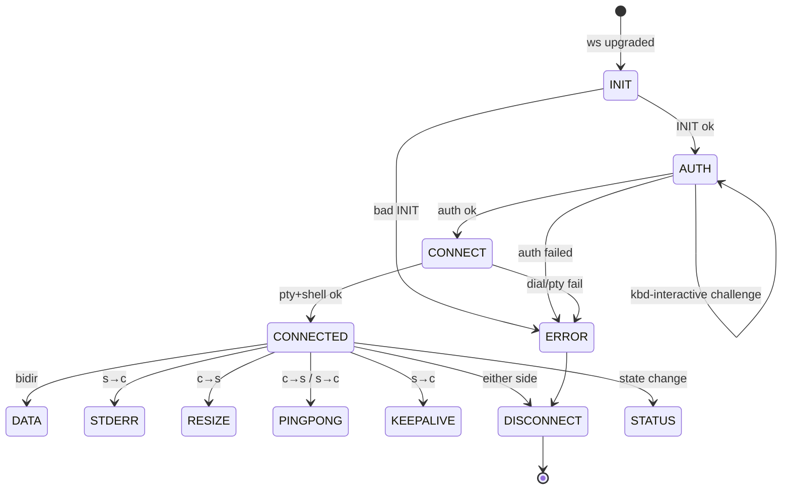
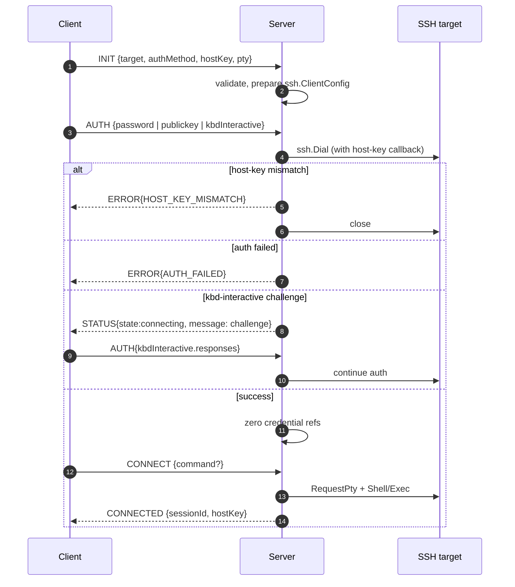

# Phase 6 — WebSocket Protocol Specification

**Document status:** Proposed
**Last updated:** 2026-07-26
**Scope:** The wire protocol between the Vue frontend and the Go backend.

This document is the normative specification of the Buddy-SSH WebSocket
protocol. The TypeScript types in `packages/shared` are the single source of
truth (ADR-0001); Go types are generated (ADR-0004). Encoding is MessagePack
primary, JSON debug (ADR-0004).

---

## 1. Transport

- **Scheme:** `wss://` in production (NFR-S1). `ws://` only for local dev.
- **Endpoint:** `GET /ws`.
- **Subprotocol negotiation:** the client offers
  `Sec-WebSocket-Protocol: buddy-ssh.msgpack` (or `buddy-ssh.json` for
  debug). The server picks one; if none match, the upgrade fails.
- **Auth:** bearer token in the `Authorization: Bearer <token>` header on the
  upgrade request (ADR-0008). The token is **not** sent in any message.
- **Origin:** checked by the server against the allowlist (FR-123).
- **Read limit:** 1 MiB per frame (configurable); oversized frames close the
  connection (threat model §2.2).

---

## 2. Envelope

Every message is a single MessagePack map (or JSON object) with this shape:

```ts
interface Envelope<T = unknown> {
  /** Protocol version, semver. Current: 1. */
  v: 1
  /** Message type discriminator. */
  type: MessageType
  /** Correlation id, echoed in responses. Optional for fire-and-forget. */
  id?: string
  /** Message payload; shape depends on `type`. */
  payload: T
}
```

```ts
type MessageType =
  | 'INIT'        // c→s  start a session, declare target + auth method
  | 'AUTH'        // c→s  supply a credential (password / key / kbd-interactive response)
  | 'CONNECT'     // c→s  request PTY + shell (after successful auth)
  | 'CONNECTED'   // s→c  session is live
  | 'DATA'        // bidir terminal bytes
  | 'STDERR'      // s→c  remote stderr bytes
  | 'RESIZE'      // c→s  window-change
  | 'PING'        // c→s  liveness probe
  | 'PONG'        // s→c  liveness response
  | 'KEEPALIVE'   // s→c  keepalive notice (no action required)
  | 'STATUS'      // s→c  connection state change
  | 'ERROR'       // s→c  error (then usually closes)
  | 'DISCONNECT'  // bidir graceful close
```

**Reserved type ranges (future, FR-160):**

| Range | Reserved for |
|-------|--------------|
| `SFTP_*` | SFTP messages |
| `FWD_*` | Port forwarding |
| `XFER_*` | File transfer |
| `PLUGIN_*` | Plugin protocol |

---

## 3. Message payloads

All payloads are defined as Zod schemas in `packages/shared` and generated as
Go structs. Field names are short to keep wire size small.

### 3.1 INIT (c→s)

```ts
interface InitPayload {
  target: {
    host: string
    port: number            // default 22
    username: string
  }
  authMethod: 'password' | 'publickey' | 'keyboard-interactive'
  /** Trust data for host-key verification (FR-80..85). */
  hostKey: {
    mode: 'first-use' | 'pinned'
    /** Base64 SHA-256 fingerprint of the pinned key, when mode='pinned'. */
    fingerprint?: string
    /** Key algorithm hint, e.g. 'ssh-ed25519'. Optional. */
    algorithm?: string
  }
  /** Terminal preferences applied to the PTY. */
  pty: {
    term: string            // e.g. 'xterm-256color'
    cols: number
    rows: number
  }
  /** Optional client metadata. */
  client?: { version: string }
}
```

### 3.2 AUTH (c→s)

```ts
interface AuthPayload {
  /** For 'password': the password. For 'publickey': the key + passphrase. */
  password?: string
  publickey?: {
    /** OpenSSH or PEM formatted private key. */
    key: string
    passphrase?: string
  }
  /** For 'keyboard-interactive': response to a challenge. */
  kbdInteractive?: {
    challengeId: string
    responses: string[]
  }
}
```

🔒 The backend uses these fields only to build `ssh.AuthMethod`, then drops
references (FR-101). They are never logged (FR-102).

### 3.3 CONNECT (c→s)

```ts
interface ConnectPayload {
  /** Optional remote command; if omitted, an interactive shell is requested. */
  command?: string
  /** Environment variables to request (best-effort; server may reject). */
  env?: Record<string, string>
}
```

### 3.4 CONNECTED (s→c)

```ts
interface ConnectedPayload {
  sessionId: string         // backend-generated, for logging correlation
  serverId: string          // backend instance id (for LB diagnostics)
  /** The host key actually presented by the target (for client pinning). */
  hostKey: {
    algorithm: string
    fingerprint: string     // base64 SHA-256
  }
}
```

### 3.5 DATA (bidir)

```ts
interface DataPayload {
  /** Raw terminal bytes. MessagePack `bin` type; JSON mode uses base64. */
  data: Uint8Array
}
```

### 3.6 STDERR (s→c)

```ts
interface StderrPayload {
  data: Uint8Array
}
```

### 3.7 RESIZE (c→s)

```ts
interface ResizePayload {
  cols: number
  rows: number
  pixelWidth?: number
  pixelHeight?: number
}
```

### 3.8 PING / PONG

```ts
interface PingPayload { timestamp: number }   // client clock, ms
interface PongPayload { timestamp: number; serverTime: number }
```

### 3.9 KEEPALIVE (s→c)

```ts
interface KeepalivePayload { /** empty */ }
```

### 3.10 STATUS (s→c)

```ts
interface StatusPayload {
  state: 'connecting' | 'connected' | 'reconnecting' | 'disconnected' | 'error'
  message?: string
}
```

### 3.11 ERROR (s→c)

```ts
interface ErrorPayload {
  code: ErrorCode
  message: string           // user-friendly; no internal details
}
type ErrorCode =
  | 'PROTOCOL_VERSION'
  | 'PROTOCOL_VIOLATION'
  | 'AUTH_FAILED'
  | 'AUTH_REQUIRED'
  | 'HOST_KEY_MISMATCH'
  | 'TARGET_UNREACHABLE'
  | 'TIMEOUT'
  | 'RATE_LIMITED'
  | 'INTERNAL'
  | 'READ_LIMIT'
```

### 3.12 DISCONNECT (bidir)

```ts
interface DisconnectPayload {
  reason?: 'client_close' | 'server_shutdown' | 'idle_timeout' | 'error'
}
```

---

## 4. State machine



**Rules:**

- Any message not valid for the current state → `ERROR{PROTOCOL_VIOLATION}`
  then close.
- `AUTH` is accepted only once per connection (replay protection, threat
  model §2.3). Keyboard-interactive may iterate via repeated `AUTH` with
  `kbdInteractive` until success or failure.
- `DATA`/`RESIZE` before `CONNECTED` → `ERROR{PROTOCOL_VIOLATION}`.
- `PING` may be sent in any state after `CONNECTED`; server responds with
  `PONG` within 5 s or the client considers the connection dead.

---

## 5. Authentication flow



---

## 6. Reconnect strategy

- The client owns reconnect logic (ADR-0005). The backend never resumes a
  dead session.
- On WebSocket close:
  1. The tab enters `reconnecting` state; scrollback is preserved client-side.
  2. The client waits `backoff = min(2^n * 500ms, 30s)` + jitter.
  3. The client opens a new WS, re-sends `INIT` + `AUTH` (re-auth required,
     FR-8).
  4. On `CONNECTED`, the terminal is reattached; the client may optionally
     re-emit the last resize.
- After N consecutive failures (default 5), the tab enters `error` state and
  stops retrying until user action.

---

## 7. Keepalive

- **WebSocket layer:** client sends `PING` every 30 s; server replies `PONG`.
  No reply within 10 s → client considers the connection dead and reconnects.
- **SSH layer:** server sends `keepalive@openssh.com` every 30 s
  (configurable). Failure to get a response within 3 attempts → server closes
  the SSH session and sends `DISCONNECT{reason: idle_timeout}`.
- **Idle timeout:** if no `DATA`/`RESIZE`/`PING` for `config.IdleTimeout`
  (default 5 min), the server sends `DISCONNECT{reason: idle_timeout}` and
  closes (FR-10).

---

## 8. Versioning & backward compatibility

- `v` field in the envelope is the protocol version (semver). Current: `1`.
- The server rejects unknown `v` with `ERROR{PROTOCOL_VERSION}` (threat model
  §2.3, no silent downgrade).
- **Additive changes** (new optional fields, new message types in reserved
  ranges) do not bump the major version.
- **Breaking changes** bump the major version; the server supports at most
  one previous major version during a deprecation window.
- A deprecation policy document will accompany any future major bump.

---

## 9. Security considerations

- The token is never carried in messages (only on the WS upgrade header).
- `AUTH` payloads are the only messages carrying secrets; they are processed
  once and dropped (FR-101, FR-102).
- All messages are schema-validated on receipt; invalid messages close the
  connection (threat model §2.3).
- `DATA` bytes are opaque to the backend; the backend never inspects or logs
  them.
- `ERROR` messages carry no internal stack traces or host-internal details.

---

## 10. Example exchange (MessagePack, illustrative)

```
c→s  INIT    {v:1, type:'INIT',    payload:{target:{host:'10.0.0.1',port:22,username:'ops'}, authMethod:'password', hostKey:{mode:'first-use'}, pty:{term:'xterm-256color',cols:80,rows:24}}}
c→s  AUTH    {v:1, type:'AUTH',    payload:{password:'••••••'}}
c→s  CONNECT {v:1, type:'CONNECT', payload:{}}
s→c  CONNECTED {v:1, type:'CONNECTED', payload:{sessionId:'01H...', serverId:'buddy-1', hostKey:{algorithm:'ssh-ed25519', fingerprint:'AAAA...'}}}
c→s  DATA    {v:1, type:'DATA',    payload:{data:<80 bytes of 'ls -la\n'>}}
s→c  DATA    {v:1, type:'DATA',    payload:{data:<4096 bytes of ls output>}}
c→s  RESIZE  {v:1, type:'RESIZE',  payload:{cols:120, rows:40}}
c→s  PING    {v:1, type:'PING',    payload:{timestamp:1722000000000}}
s→c  PONG    {v:1, type:'PONG',    payload:{timestamp:1722000000000, serverTime:1722000000042}}
c→s  DISCONNECT {v:1, type:'DISCONNECT', payload:{reason:'client_close'}}
```
