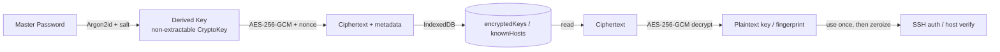
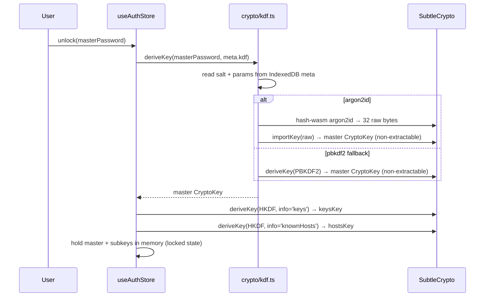

# Phase 8 — Cryptography Specification

**Document status:** Proposed
**Last updated:** 2026-07-26
**Scope:** Client-side encryption of locally stored private keys and the
known-hosts database.

This document specifies the key-derivation function, cipher, metadata
envelope, key lifecycle, rotation strategy, and memory handling. It
implements FR-62, FR-104, FR-105, NFR-S5, and the secret-lifecycle invariants
in [`02-threat-model.md`](./02-threat-model.md) §4.

> **Golden rule:** Never implement custom cryptography. Only the Web Crypto
> API (`SubtleCrypto`) and the audited `hash-wasm` library are permitted
> (SRS §5 constraint 4).

---

## 1. Overview



---

## 2. Algorithms

| Purpose | Algorithm | Library | Rationale |
|---------|-----------|---------|-----------|
| Key derivation | **Argon2id** | `hash-wasm` | OWASP-recommended memory-hard KDF; WASM, audited C, ~438 ops/s, 11 kB. |
| Fallback KDF | PBKDF2-SHA-256 (600 000 iters) | Web Crypto `SubtleCrypto` | Used only if WASM is blocked; documented. |
| Authenticated encryption | **AES-256-GCM** | Web Crypto `SubtleCrypto` | Browser-native, hardware-accelerated, AEAD. |
| Subkey derivation | HKDF-SHA-256 | Web Crypto | Derive distinct keys for keys vs known-hosts from one master key. |
| Host-key fingerprint | SHA-256, Base64 | Web Crypto | Matches OpenSSH display format. |

---

## 3. Argon2id parameters

OWASP-aligned (2024 recommendations), tuned for a browser interactive unlock
(target ~0.5-1 s on a mid-range laptop).

| Parameter | Value | Notes |
|-----------|-------|-------|
| `memorySize` | 65 536 KiB (64 MiB) | Memory cost. |
| `iterations` | 3 | Time cost. |
| `parallelism` | 4 | Threads; browsers cap WASM threads, so this is a hint. |
| `hashLength` | 32 bytes | AES-256 key length. |
| `salt` | 16 bytes, random per master password | Stored in `meta.kdf.salt`. |

Parameters are stored alongside the salt in `meta` (IndexedDB) so they can be
tuned in future versions without breaking existing data. The KDF function is
selected by `meta.kdf.algo` (`argon2id` or `pbkdf2`).

### 3.1 PBKDF2 fallback

If `hash-wasm` fails to load (e.g., WASM disabled), the system falls back to
PBKDF2-SHA-256 with 600 000 iterations and a 16-byte salt, via
`SubtleCrypto.deriveKey`. The user is warned that the fallback is weaker and
that enabling WASM is recommended. The chosen algorithm is recorded in
`meta.kdf.algo`.

---

## 4. Encryption envelope

Every encrypted record (`encryptedKeys`, `knownHosts`) stores a
`CryptoMetadata` object alongside its ciphertext:

```ts
interface CryptoMetadata {
  /** Envelope version; bump on algorithm changes. */
  version: 1
  kdf: {
    algo: 'argon2id' | 'pbkdf2'
    params: Argon2idParams | Pbkdf2Params
    salt: string           // base64
  }
  cipher: {
    algo: 'AES-256-GCM'
    nonce: string          // base64, 96-bit, random per record
    /** Optional authenticated associated data (e.g., record id). */
    aad?: string
  }
  keyId: string            // links to the master key id in meta
  createdAt: number
  rotatedAt?: number
}

interface Argon2idParams {
  memorySize: number       // KiB
  iterations: number
  parallelism: number
  hashLength: number
}

interface Pbkdf2Params {
  iterations: number
  hash: 'SHA-256'
  hashLength: number
}
```

**Rules:**

- `nonce` is 96-bit, generated with `crypto.getRandomValues`, **unique per
  encryption** (never reused with the same key).
- `salt` is 128-bit, random per master password (rotated on rekey).
- `aad` (if used) binds a record to its id, preventing record swapping.
- `version` enables future algorithm migration (§7).

---

## 5. Key derivation & subkeys



- The **master CryptoKey** is `extractable: false`; it can be used to
  encrypt/decrypt but its raw bytes cannot be read by JS.
- Two **subkeys** are derived via HKDF-SHA-256 with distinct `info` labels:
  - `"buddy-ssh/keys"` → encrypts `encryptedKeys`.
  - `"buddy-ssh/knownHosts"` → encrypts `knownHosts`.
- Subkeys isolate compromise: a leak of one subkey's ciphertext context does
  not expose the other store.

---

## 6. Key lifecycle 🔒

| Phase | Action | Lifetime |
|-------|--------|----------|
| **Derive** | On `unlock(masterPassword)`, derive master + subkeys. | Session (memory only). |
| **Use** | Decrypt a key/fingerprint only when required for a connection. | Minimum: decrypt → transmit over WSS → drop reference. |
| **Auto-lock** | After `idleTimeout` (default 15 min) or on explicit lock, clear all CryptoKeys and decrypted material. | — |
| **Zeroize** | Best-effort clear of any `Uint8Array`/`ArrayBuffer` holding plaintext after use. | Immediate. |
| **Rekey** | On master password change: re-derive new master, re-encrypt all records, update `meta`. | One-time. |
| **Destroy** | On tab close / browser exit, memory is reclaimed by the browser. No persistent trace of derived keys. | — |

**Invariants:**

1. The master password is never stored, never transmitted, never logged.
2. Derived CryptoKeys are never persisted; they live only in `useAuthStore`.
3. Decrypted private keys exist in memory only for the minimum time required
   to send the `AUTH` message over WSS (FR-104).
4. `useAuthStore.lock()` clears all keys and calls `zeroize` on any tracked
   plaintext buffers (FR-105).

### 6.1 Zeroization

`crypto/zeroize.ts` exposes `zeroize(buf: Uint8Array | ArrayBuffer)` which
fills the buffer with zeros. Limitations:

- JavaScript strings are immutable; passphrase strings cannot be reliably
  zeroized. We minimize their lifetime and accept this limitation
  (documented).
- `CryptoKey` objects cannot be zeroized; we drop all references so the GC
  can collect them, and rely on the browser to clear the underlying memory.

---

## 7. Rotation strategy

### 7.1 Master password change (rekey)

1. User enters old and new master passwords.
2. Derive old master key; decrypt all `encryptedKeys` and `knownHosts`.
3. Generate a new 16-byte salt; derive new master key + subkeys.
4. Re-encrypt all records with new nonces; update `meta.kdf.salt` and
   `meta.keyId`.
5. Write all records in a single IndexedDB transaction.
6. Zeroize old plaintext and old key references.

### 7.2 Algorithm deprecation

- If a future version deprecates Argon2id (unlikely) or AES-256-GCM, the
  `version` field in `CryptoMetadata` triggers a lazy re-encryption on next
  unlock: read with old algo, write with new algo + `version` bump.
- The `meta.kdf.algo` field selects the KDF; a migration path is documented
  per version bump.

---

## 8. Threat mitigations

| Threat | Mitigation |
|--------|------------|
| Offline attack on IndexedDB | Argon2id (64 MiB, 3 iters) makes brute-force expensive. |
| Memory scraping (lost unlocked device) | Auto-lock after idle; short plaintext lifetime. |
| Tampering with ciphertext | AES-GCM authenticated encryption detects modification. |
| Nonce reuse | Random 96-bit nonce per encryption; never reused with same key. |
| Key compromise across stores | HKDF subkeys isolate `encryptedKeys` from `knownHosts`. |
| XSS exfiltrating derived key | `extractable: false` CryptoKey; CSP + Trusted Types. |
| Weak master password | Document guidance; future WebAuthn second factor. |

---

## 9. API surface (`crypto/`)

```ts
// crypto/kdf.ts
export async function deriveMasterKey(
  masterPassword: string,
  kdfMeta: KdfMeta,
): Promise<CryptoKey>            // non-extractable

// crypto/cipher.ts
export async function encrypt(
  key: CryptoKey,
  plaintext: Uint8Array,
  aad?: Uint8Array,
): Promise<{ ciphertext: ArrayBuffer; nonce: Uint8Array }>

export async function decrypt(
  key: CryptoKey,
  ciphertext: ArrayBuffer,
  nonce: Uint8Array,
  aad?: Uint8Array,
): Promise<Uint8Array>

// crypto/keys.ts
export async function deriveSubkey(
  master: CryptoKey,
  info: string,
): Promise<CryptoKey>

// crypto/zeroize.ts
export function zeroize(buf: Uint8Array | ArrayBuffer): void
```

All functions are pure and unit-tested. The `useAuthStore` is the only
caller permitted to hold long-lived CryptoKeys.

---

## 10. Testing

- **KDF:** derive a key with known salt + params, assert deterministic output
  (regression vector).
- **Cipher:** encrypt → decrypt round-trip; tamper ciphertext → decrypt
  throws; tamper nonce → decrypt throws; wrong key → decrypt throws.
- **Subkeys:** assert `keys` and `knownHosts` subkeys differ.
- **Zeroize:** assert buffer is all zeros after call.
- **Rekey:** decrypt with old, re-encrypt with new, decrypt with new, assert
  equality; assert old key cannot decrypt new records.
- **Fallback:** assert PBKDF2 path produces a usable key when WASM is
  unavailable (mock `hash-wasm` failure).
- **Performance:** assert Argon2id derivation completes in < 2 s on a
  reference machine (CI sanity check, not a hard gate).
