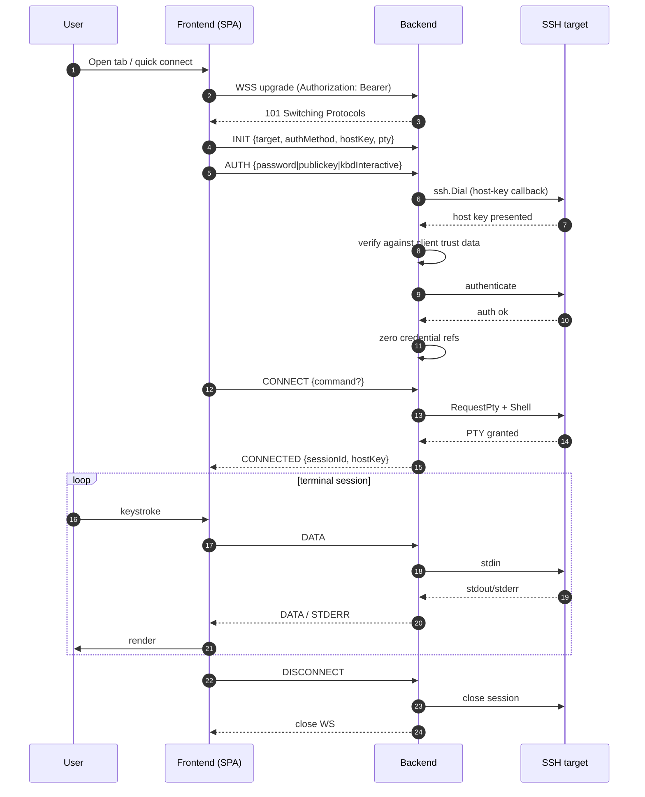
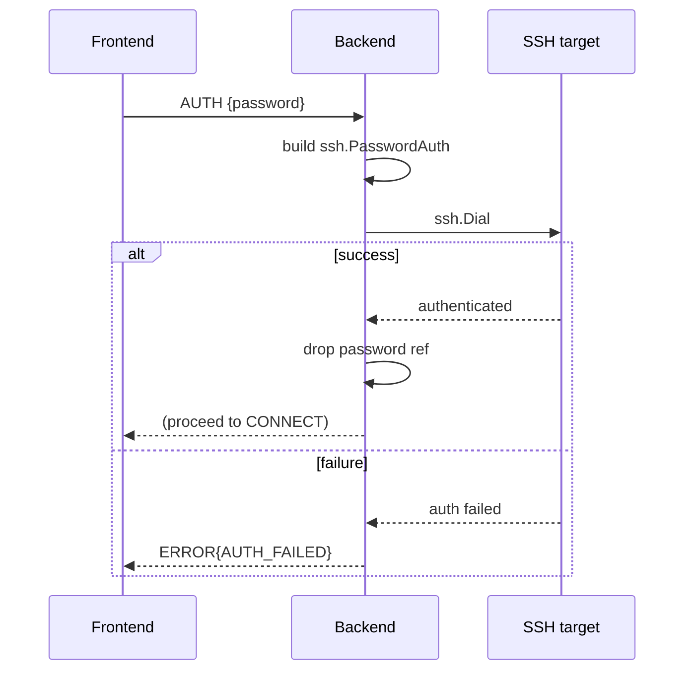
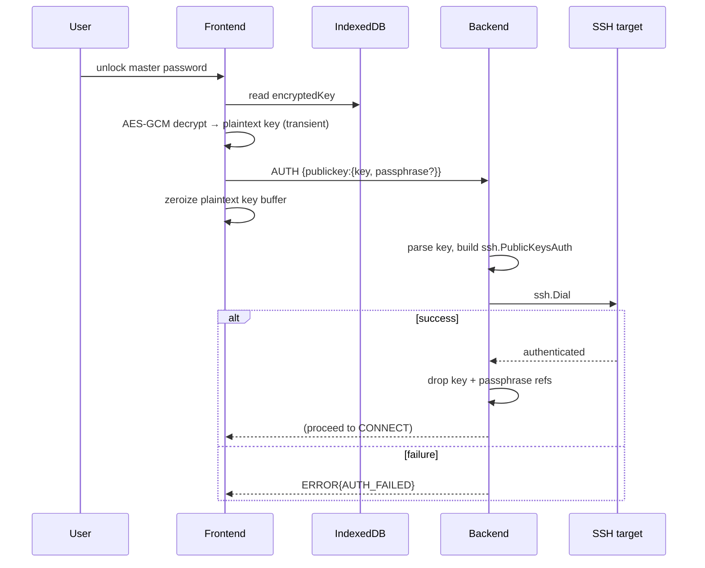
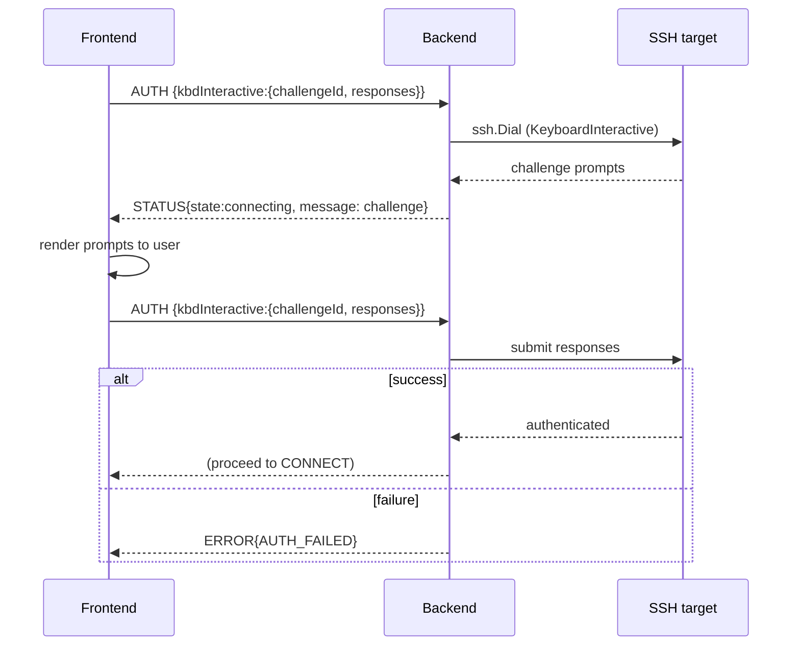
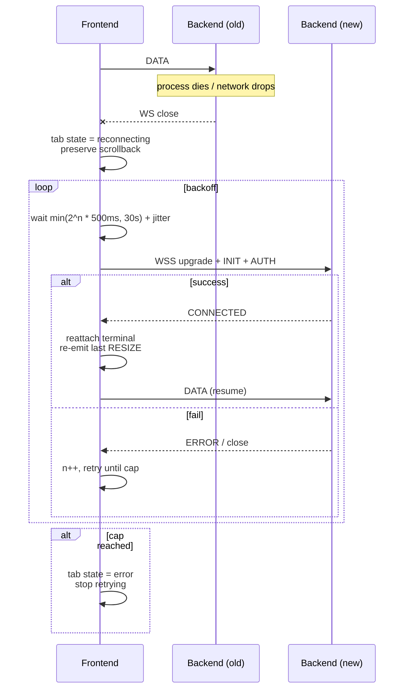
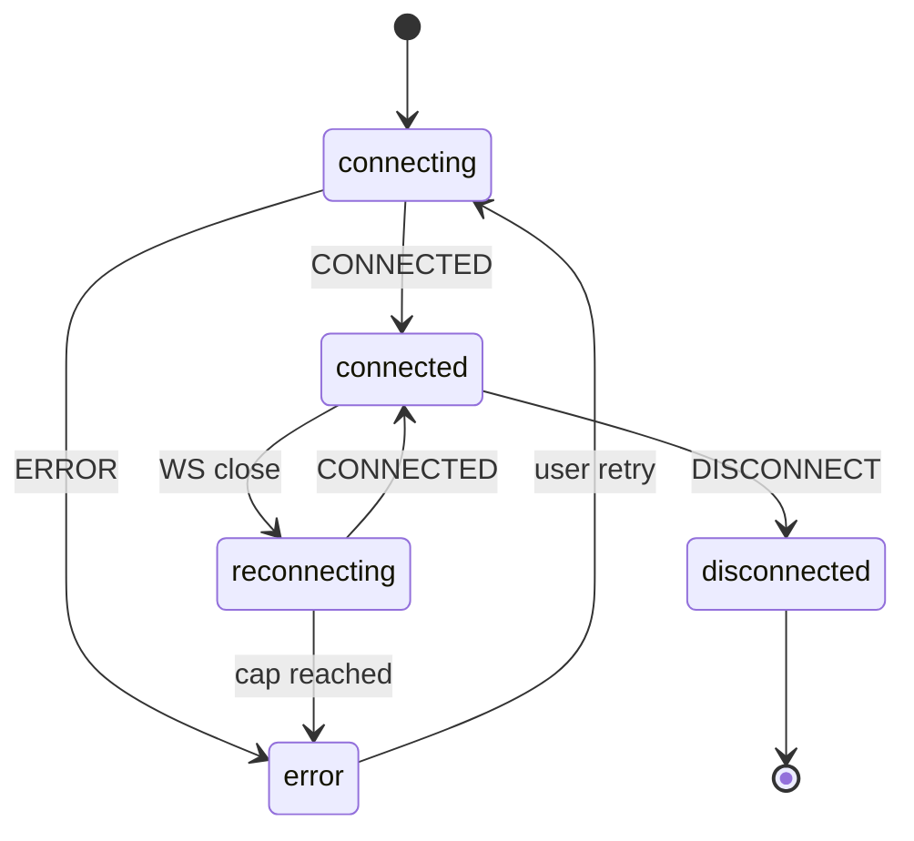
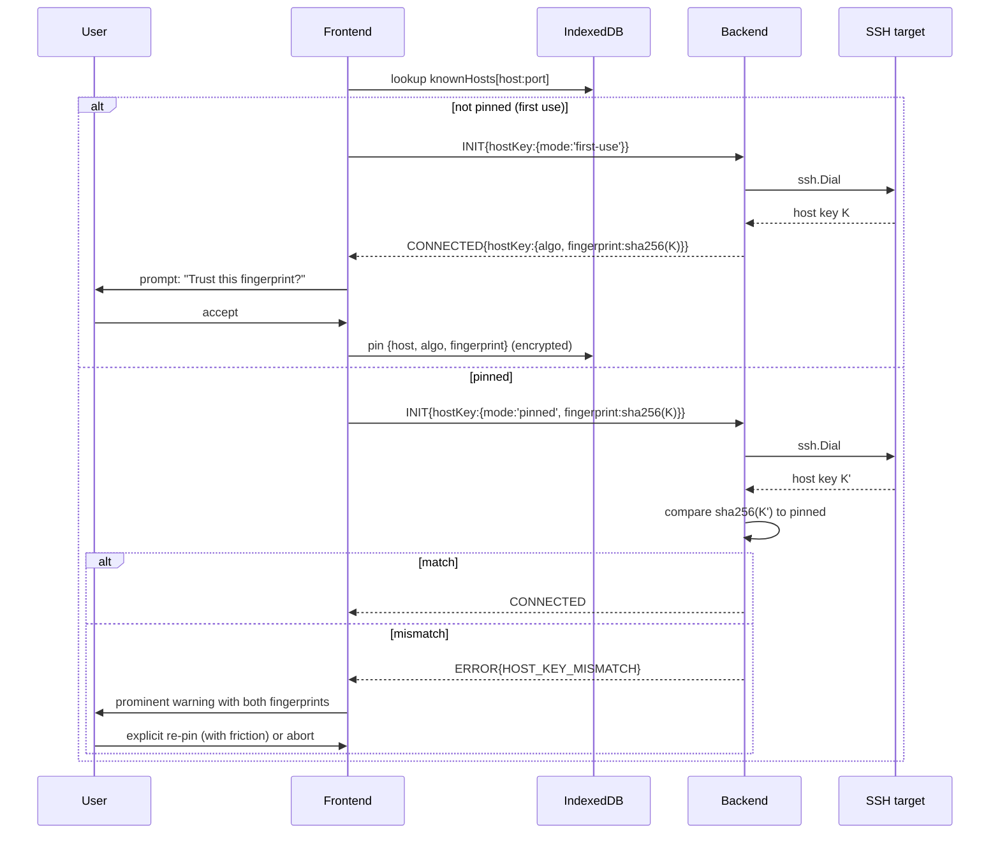
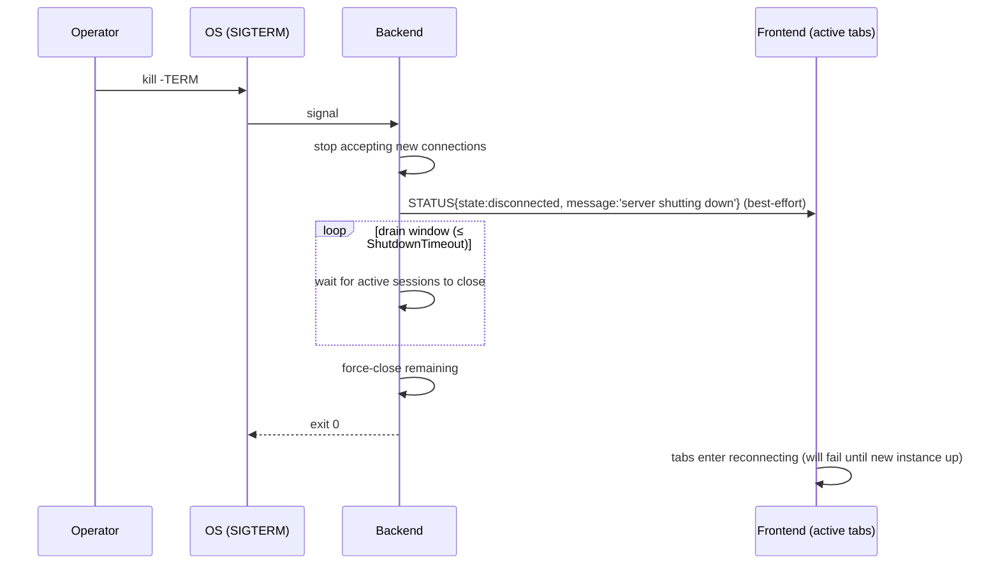

# Phase 9 — Sequence & State Diagrams

**Document status:** Proposed
**Last updated:** 2026-07-26
**Scope:** Mermaid diagrams for every lifecycle in Buddy-SSH.

This document consolidates the dynamic views: SSH connection lifecycle,
authentication, terminal resize, WebSocket reconnect, host-key verification,
and the secret lifecycle. Static views live in
[`04-frontend-design.md`](./04-frontend-design.md) and
[`05-backend-design.md`](./05-backend-design.md).

---

## 1. SSH connection lifecycle



---

## 2. Authentication (all methods)

### 2.1 Password



### 2.2 Public key (encrypted, in-memory)



### 2.3 Keyboard-interactive



---

## 3. Terminal resize

```mermaid
sequenceDiagram
    participant U as User
    participant Pane as TerminalPane
    participant RO as ResizeObserver
    participant T as useTerminal
    participant TR as Transport
    participant BE as Backend
    participant SSH as ssh.Session
    U->>Pane: resize window / split
    Pane->>RO: fires
    RO->>T: layout change
    T->>T: debounce 50ms
    T->>TR: RESIZE{cols, rows}
    TR->>BE: RESIZE
    BE->>SSH: WindowChange(cols, rows)
    SSH-->>BE: ok
    Note over T: no response expected; best-effort
```

---

## 4. WebSocket reconnect



**State machine (client tab):**



---

## 5. Host-key verification (TOFU)



---

## 6. Secret lifecycle (end-to-end)

```mermaid
sequenceDiagram
    autonumber
    participant U as User
    participant FE as Frontend
    participant IDB as IndexedDB
    participant WC as Web Crypto / hash-wasm
    participant BE as Backend
    participant T as SSH target
    U->>FE: enter master password
    FE->>WC: Argon2id(password, salt) → 32 raw bytes
    FE->>WC: importKey(raw, extractable=false) → master CryptoKey
    FE->>WC: HKDF(master, 'keys') → keysKey
    FE->>IDB: read encryptedKey record
    FE->>WC: AES-GCM decrypt(keysKey, ciphertext, nonce) → plaintext key
    FE->>BE: WSS AUTH {publickey:{key}} (over TLS)
    FE->>WC: zeroize plaintext key buffer
    BE->>BE: build ssh.PublicKeysAuth (in memory)
    BE->>T: ssh.Dial
    T-->>BE: authenticated
    BE->>BE: drop key reference; zero buffers where practical
    BE-->>FE: CONNECTED
    Note over FE,IDB: master password & derived keys never leave browser
    Note over BE: backend never persists, never logs credentials
```

---

## 7. Graceful shutdown (backend)



---

## 8. Auto-lock (frontend)

```mermaid
stateDiagram-v2
    [*] --> locked
    locked --> unlocked: unlock(masterPassword)
    unlocked --> locked: explicit lock()
    unlocked --> locked: idle timeout (15m)
    unlocked --> locked: tab close / visibility hidden (configurable)
    note right of unlocked: derived CryptoKey + decrypted material in memory
    note right of locked: all CryptoKeys dropped; buffers zeroized
```


